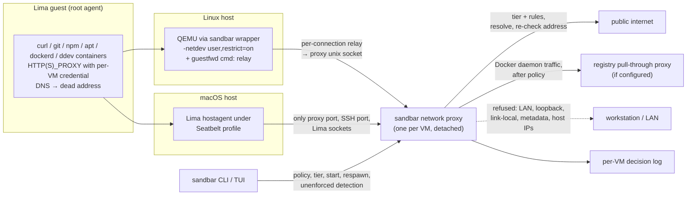

# Plan: Egress Proxy and Network Confinement for Local Lima VMs

## Original Work Order

> ok, I'm interested in adding the egress proxy to sandbar. However, I'm not sure how to do that especially with supporting proxmox. I suppose we'd have to spin up a VM in proxmox to route traffic through? I also like keeping secrets out of the vm. We could have a much better secrets manager. The denylist is good too. I don't think the image layers makes sense at the moment.
>
> right, you are probably firewalled right now. Let's update the plan to be lima only and we'll do proxmox as a followup.

The request followed a comparison of sandbar with [devvm](https://devvm.dev), whose per-VM egress proxy, network tiers, placeholder secrets and credential-minting denylist were the features under discussion.

## Plan Clarifications

| Question | Answer |
| --- | --- |
| The work splits into (A) the egress proxy with confinement and tiers, (B) placeholder secrets and a new secrets manager, and (C) a GitHub/GitLab denylist. B and C depend on A. One plan or several? | **A now; B and C are follow-up plans** built on the shipped proxy. |
| Remote-Lima-over-SSH would need a proxy binary on the remote host, possibly for another OS/arch. Include it? | **Local Lima only.** Remote-Lima VMs stay unconfined, are reported as such, and get a follow-up plan alongside Proxmox. |
| Default network tier for a new VM? | **`internet`**: any public host; the LAN, private ranges and the workstation's own services are refused. `allowlist` is opt-in. |
| Backwards compatibility for VMs that exist at upgrade time? | **Confine on next start.** An existing VM gets the default tier the next time sandbar starts it; its Lima config is rewritten while it is stopped. A VM already running stays unconfined and is shown as unenforced until restarted. No other compatibility shims. |
| How much interface for tiers, rules and the log? | **Tier + rules + log, with CLI/TUI parity**: choose a tier at create and change it later; allow/deny rules globally and per VM; a decision log readable from the CLI and from the VM's tile. |
| devvm (MIT) has solved the Lima-specific confinement. How should its code be used? | **Reference and reimplement.** Read devvm's design and code for approach and edge cases; write sandbar's own implementation against its own seams. No copied code, no third-party notices. |
| Confirmed scope (approval gate) | Local Lima on Linux and macOS; per-VM proxy run by the `sandbar` binary; QEMU `restrict=on` + `guestfwd` on Linux; Seatbelt-confined hostagent on macOS; no guest DNS; `_config` network guard; unenforced detection; tiers `open`/`internet`/`allowlist`/`none`; deny-beats-allow; decision log; existing VMs confined on next start; Docker/ddev/Composer working behind the proxy; base-image builds left unconfined; ddev end-to-end on the local Linux KVM host; manual macOS checklist. **Approved 2026-11-08.** |
| *(Refinement, user)* Finalize installs agents, runs apt and clones the project behind the proxy, so a `none` VM (agent API hosts only) would fail create and reset. How do the built-in provisioning rules apply? | **Built-ins are always on for `allowlist`. A `none` VM gets them only during a provisioning window**: while sandbar itself drives create, reset or finalize. Afterwards it drops back to the agent API hosts. |
| *(Refinement, user)* A VM may name a Docker registry pull-through proxy (`--docker-proxy-host`, usually a LAN host on port 3128), but a confined guest's Docker daemon must use sandbar's proxy. How do they combine? | **Chain.** Sandbar's proxy applies the VM's policy, then sends the Docker daemon's connections on through the configured registry proxy. |
| *(Refinement, user)* Where do the new real-VM tests run? | **All in CI**, each suite in its own parallel job: the confinement e2e and the ddev e2e. |
| *(Refinement, auto-resolved from code)* The plan named the binary `sand` and a `sand list` command. | The executable is `sandbar` (`cmd/sandbar`). There is no list subcommand (`cmd/sandbar/main.go`), so `sandbar network show` is the CLI's tier and enforcement listing. |
| *(Refinement, auto-resolved from code)* Does a new `vm.CreateConfig` field need a marker schema change? | Yes. Every additive marker change so far has bumped `provider.MarkerSchemaVersion` (currently 4) and its mirror `registry.adoptSchemaVersion`. Both go to **5**. An absent tier decodes as empty, meaning "not recorded yet". |
| *(Refinement, verified on this host)* `Configure` edits `lima.yaml` with `limactl edit --set <expr>`, and the expression is an argv element. How does the credential stay out of process arguments? | **Sandbar writes the `env:` block into the stopped instance's `lima.yaml` itself and sets the file to mode 0600.** `strenv()` is not an option: Lima disables yq's `env`, `load` and `load_str` operators on purpose (`limactl help yq-restrictions`). `limactl edit --set '… strenv(X)'` fails with `env operations have been disabled` and writes nothing. A direct write of `env:` was delivered to the guest's `/etc/environment` on the next boot. Lima creates `lima.yaml` as 0644. |
| *(Refinement, verified on this host)* QEMU's `guestfwd` to a chardev (`-tcp:host:port`) opens one connection when QEMU starts and serves guest connections through it. | Use the **per-connection `cmd:` form**. QEMU spawns a small `sandbar` relay for each guest connection, and the relay joins the VM proxy's unix socket. Measured on QEMU 10.0.13 under `restrict=on`, against a host server that waits 2s before replying: **`cmd:`** served 5 concurrent requests together in about 2.1s, failed closed while the server was down, and worked on the next connection after a restart. **`tcp:`** answered 1 of the 5, delivered `/req4`'s response to `req5`'s connection, timed the other four out, and never reconnected after a restart. |
| *(Refinement, verified on this host)* Lima runs the QEMU binary for feature probes as well as to boot. | The wrapper passes **informational invocations** through unchanged. Lima 2.2.0 makes exactly these: `-M none -accel help`, `-M none -netdev help`, `-machine help`, `-cpu help -machine q35`, `--version`. Then it boots with exactly one `-netdev user,id=net0,net=192.168.5.0/24,dhcpstart=192.168.5.15,hostfwd=tcp:127.0.0.1:<port>-:22`. Only an invocation that would boot a guest must have the expected network shape, or the wrapper refuses it. |
| *(Refinement, verified on this host)* Does Lima's `QEMU_SYSTEM_<ARCH>` override reach QEMU, and what still works under `restrict=on`? | **Yes.** `QEMU_SYSTEM_X86_64` in `limactl start`'s environment is inherited by the hostagent and used for every QEMU invocation. Under `restrict=on`, Lima's SSH, guest agent and same-port forwarding (guest `127.0.0.1:PORT` reachable on the host) all worked. As root in the guest, DNS timed out, and direct TCP to `1.1.1.1` and to the host at `192.168.5.2` failed immediately. `/proc/<qemu.pid>/cmdline` shows the rewritten netdev, so the unenforced check can read it. |

## Executive Summary

A sandbar VM already has no writable path back to the workstation, but it has unrestricted network access. A compromised or misdirected agent with root in the guest can reach the user's LAN, services listening on the workstation's loopback (Lima's user-mode network exposes the host at `192.168.5.2`), cloud metadata addresses, and any host on the internet. The security model currently answers this with "run it on a network you trust." This plan closes the LAN and host half of that gap for local Lima VMs and gives users an opt-in allowlist for the internet half.

Each confined VM gets its own proxy process on the workstation, run by the `sandbar` binary itself. The guest is forced through it at a layer the guest cannot reach even as root. On Linux, sandbar starts Lima's QEMU through a wrapper that turns on `restrict=on` for QEMU user-mode networking and adds one `guestfwd` address. QEMU relays each connection to that address to the proxy. On macOS, the Lima hostagent, which carries the VM's traffic, runs under a Seatbelt profile that can reach only the proxy, the VM's SSH port and Lima's own sockets. Guest DNS points nowhere. The proxy resolves names after applying policy, then checks the resolved addresses again so DNS rebinding cannot reach a refused range. The proxy applies one of four tiers with allow/deny rules (deny beats allow) and logs every decision. When a VM has a Docker registry pull-through proxy configured, the Docker daemon's traffic is chained to it after policy.

The design follows devvm's, which has already worked through the Lima-specific traps, but is implemented fresh against sandbar's provider, Lima and provisioning seams. It ships with a default tier (`internet`) that blocks the pivot into the user's network while leaving ordinary Drupal/ddev work, Docker pulls and Composer installs working. CI proves it end to end on real VMs, ddev included. The same proxy is the foundation the follow-up plans (placeholder secrets, the denylist, remote Lima, Proxmox) build on.

## Context

### Current State vs Target State

| Current State | Target State | Why? |
| --- | --- | --- |
| The guest can open a connection to any address, including the LAN and the workstation's loopback services (via `192.168.5.2`). | A confined guest can reach only its own proxy; every other connection, DNS lookup and UDP packet fails immediately, even for root. | An agent running with permissions skipped must not be able to pivot into the user's network or host services. |
| No network policy exists. | Four tiers (`open`, `internet`, `allowlist`, `none`) plus global and per-VM allow/deny rules; a deny beats any allow. | Users need a sensible default and a way to tighten or loosen it per VM. |
| Nothing records what a VM connected to. | Every proxy decision (allowed or refused, host, port, reason) is logged per VM and readable from the CLI and the TUI. | A blocked host must be diagnosable, and the log is the audit trail for what an agent reached. |
| Guest DNS uses Lima's host resolver. | Guest DNS points at an address nothing listens on; the proxy resolves names after policy. | DNS is otherwise an unpoliced exfiltration and probing channel, and resolving in the proxy lets it refuse private results. |
| A Docker registry pull-through proxy (`--docker-proxy-host`) is the Docker daemon's direct proxy. | On a confined VM, the Docker daemon uses sandbar's proxy, which chains its connections to the registry proxy after policy. | The guest has no direct route to the registry proxy any more, but the cache should keep working. |
| Lima `_config/default.yaml` / `override.yaml` (or a hand edit) can give a VM an extra network that bypasses any policy. | Sandbar refuses to start a confined VM whose effective config has a network sandbar didn't give it, or while those `_config` files define networks. | A second NIC is a route around the proxy. |
| `limactl start` and sandbar's start are equivalent. | A VM started outside sandbar (or started before the upgrade) is detected and shown as **unenforced** on its tile and in `sandbar network show`. | Confinement exists only if sandbar started the VM; the user must be able to see when it doesn't hold. |
| The security model says Lima VMs are safe only on a trusted network. | The security model states exactly what each tier refuses and what remains open. | Documentation must match the boundary that now exists. |

### Background

- **Sandbar's Lima VMs use Lima's default user-mode network.** Neither the base overlay nor `Configure` (`internal/lima/client.go`) sets `networks:`, so Linux hosts run QEMU's `-netdev user` (slirp) and macOS hosts use vz with Lima's user-mode network carried by the hostagent. Both confinement mechanisms depend on that. This dev box runs `limactl` 2.2.0.
- **`Configure` edits `lima.yaml` with `limactl edit --set <yq expression>`.** The expression is a process argument, and Lima disables yq's environment and file-reading operators, so `limactl edit` cannot carry a secret without putting it in argv. This matters for the proxy credential (Component 5).
- **Confinement spike results (Lima 2.2.0, QEMU 10.0.13, this host, 2026-11-08).** These are recorded in Plan Clarifications:
  - the `QEMU_SYSTEM_X86_64` override works;
  - Lima's SSH, guest agent and forwarding survive `restrict=on`;
  - `cmd:` `guestfwd` handles concurrency and proxy restarts, and `tcp:` does not;
  - a direct `env:` write reaches the guest.
  The spike VM used Lima's stock Debian 13 template. Its containerd boot requirement needs the network, so `limactl start` waited until its timeout for a `running` event even though the VM was usable. Sandbar's base overlay already turns containerd off (`internal/provision/overlay.go`). Every other Lima boot requirement must also complete without network.
- **devvm's approach, from its `docs/internals/lima.md`**:
  - Linux wraps QEMU, adds `restrict=on` to Lima's single `-netdev user,id=net0,…`, and adds one `guestfwd` address (`192.168.5.4:3128`) wired to the VM's proxy. The wrapper refuses to start QEMU if the arguments aren't that shape.
  - macOS runs the hostagent under `sandbox-exec` with a per-VM profile allowing connections only to the VM's SSH port, its proxy on loopback, Lima's unix sockets and an SSH agent, and allowing listening only on the SSH port and Lima's sockets. The guest reaches the proxy at `192.168.5.2`.
  - Lima's DNS is turned off and the guest resolver points at a dead address.
  - The proxy URL carries a per-VM password, written into the VM's `lima.yaml` (mode 600) rather than any process's arguments.
  - The proxy follows the hostagent's `ha.pid` and exits with it.
  - A VM started with plain `limactl start` is reported as `unenforced`.
  - `sandbox-exec` is deprecated by Apple.
- **devvm also replaces Lima's port forwarding** with its own forwarder. Lima binds its forwards with `SO_REUSEADDR`, and on macOS they can steal `localhost` connections from a host program bound to `*:PORT`. That behaviour already exists in sandbar; this plan does not introduce it, and replacing the forwarder is out of scope. Sandbar keeps Lima's same-port loopback forwarding, which `internal/landreview` and the web-servers documentation depend on.
- **Every work-VM start goes through the provisioner or the provider.** `lima.Client.Start`/`StartStreaming` are called from `limaProvider.Start`/`StartStreaming` (`internal/provider/local.go`), from create/reset/finalize paths in `internal/provision/provision.go`, and from template restore (`internal/provision/template.go`). One call site in `provision.go` starts the shared base (`cfg.BaseName`). The others start work VMs or templates, which run untrusted code and must be confined. `limaProvider` is shared by the local and remote-Lima providers; only the local one is confined in this plan.
- **The Docker registry proxy** (`vm.CreateConfig.DockerProxyHost`, port fixed at 3128 by `roles/dev-tools` defaults) is configured by the `dev-tools` role, which runs only in the base and full phases, never in finalize. That role installs the registry proxy's CA and a `docker.service.d/http-proxy.conf` drop-in. Published base images carry neither. This plan changes neither the role nor the CA installation.
- **There is no `sandbar list` command.** VMs are listed by the TUI's refresh and resolved per command through `resolveVMProfile`.
- **Plan 22 (baked base images) is in flight** and changes how the base is produced, not how clones are started or networked. The two plans touch different seams.

## Architectural Approach

### Component 1: Network Policy Model

**Objective**: One authoritative, host-side description of what each VM may reach, persisted where the guest cannot touch it.

- **Tiers**:
  - `open`: no confinement, today's behaviour; the VM is not wrapped or sandboxed.
  - `internet` (default): any public host on any port, minus denies.
  - `allowlist`: the built-in rules plus hosts matched by a user allow rule, minus denies.
  - `none`: only the API hosts of the VM's selected coding agents, minus denies. During a provisioning window the built-in rules also apply (see below). *(See Plan Clarifications: `none` tier.)*
- **Refused by default on every confined tier**: loopback, RFC 1918, CGNAT (`100.64.0.0/10`), link-local including `169.254.169.254`, unique-local IPv6, multicast, unspecified and IPv4-mapped forms of those, and every address assigned to the workstation's own interfaces. Interface addresses change (DHCP, VPNs), so they are read when each decision is made, not once at proxy start. A rule that names an address or host explicitly may allow one of these (for example a Tailscale peer), so users have an escape hatch without an `open` tier.
- **Rules**: allow and deny entries matching a host, a wildcard subdomain suffix, or a literal address, optionally with a port. There is a global rule set and a per-VM one. A deny from either set beats any allow, built-in allows included.
- **Built-in allow rules**: a small, documented set covering what sandbar's own finalize and the base image's toolchain fetch: Debian/apt mirrors, npm, PyPI, Packagist, drupal.org and `git.drupalcode.org`, Docker Hub and common registries, GitHub, GitLab, and the coding agents' API and install hosts. It exists so that `allowlist` produces a working VM, and creating an `allowlist` VM end to end must prove that.
- **Provisioning window**: while sandbar drives a create, reset or finalize of a `none` VM, the built-in rules apply to it as well. The window is a host-side state record naming the sandbar process that opened it. Sandbar closes it when the run finishes or fails. The proxy also treats it as closed once that process has exited, so a crashed create cannot leave a `none` VM widened. Decisions taken inside the window say so in the log.
- **Persistence**:
  - A VM's tier is part of its recorded configuration (`vm.CreateConfig`), so it travels in the provenance marker and registry like the agent selections do, and it survives reset like the rest of a VM's identity. `provider.MarkerSchemaVersion` and `registry.adoptSchemaVersion` move from 4 to 5. An empty tier means "not recorded yet" and receives the default at the next start. *(See Plan Clarifications: marker schema.)*
  - Rules live in host config files under `${XDG_CONFIG_HOME:-~/.config}/sandbar/` (global, and per VM keyed by scope and name), in YAML via the already-present `gopkg.in/yaml.v3`. Writes go through a single `statelock`-guarded read-modify-write method, as with the registry, secrets and profiles stores.
  - Missing files mean "no user rules", never an error.
- **Changing policy**:
  - Rule changes and changes between confined tiers take effect on the running proxy without a restart. The proxy checks the rule and tier files' modification times before each decision and re-reads them when they change. No signal or control channel is needed.
  - Moving between `open` and any confined tier changes how the VM's process is started, so it applies at the next start, and the UI says so.
- **Pure code**: matching, refusal and tier logic is pure Go with no I/O, unit-tested exhaustively and fuzzed on host and pattern parsing.

### Component 2: The Proxy

**Objective**: A small, auditable forward proxy that is the guest's only route out.

- **Process model**:
  - Implemented in the `sandbar` binary as a hidden subcommand, so there is no second binary to ship and no new module dependency (standard library `net/http`/`net` only).
  - One process per running confined VM, started detached so it outlives the TUI or CLI invocation that started the VM.
  - On Linux it listens on a per-VM unix socket (mode 0600) under the VM's state directory. On macOS it listens on a loopback TCP port reached by the guest at `192.168.5.2`. Each VM gets its own port, allocated once and persisted. A new port is allocated only if the persisted one is taken at start, which also rewrites the guest's proxy URL.
  - It watches the VM's Lima hostagent (`ha.pid`) and exits when the hostagent does.
- **Protocol**:
  - HTTP/1.1 `CONNECT` for TLS and arbitrary TCP to permitted ports, plus plain-HTTP forwarding (apt uses `http://`).
  - No TLS interception in this plan; that belongs to the placeholder-secrets follow-up.
- **Authentication**:
  - The proxy requires a per-VM credential, generated at first confinement and stored host-side with mode 0600. It is delivered to the guest through Lima's `env:` (Component 5) and never appears in a process argument list.
  - It identifies which VM's policy applies and stops other local processes from using a VM's proxy, most importantly on macOS's loopback port.
  - A credential leaked from the guest grants only that VM's own policy.
- **Resolution and enforcement**:
  - The proxy resolves the requested name itself, applies the policy to the name, then re-checks every resolved address against the refusal set and connects only to an address that passed.
  - This closes DNS rebinding and "public name, private address" tricks.
- **Docker registry chaining** *(see Plan Clarifications: Docker registry proxy)*:
  - When the VM records a `DockerProxyHost`, the guest's Docker daemon authenticates with a separate Docker credential for the same VM.
  - Requests carrying that credential get the VM's normal policy decision on their requested destination first. An allowed connection is then opened through the registry proxy at `DockerProxyHost:3128`: a chained `CONNECT` for TLS, an absolute-URI forward for plain HTTP.
  - The registry proxy's own address is permitted because the user configured it on the host, even when it is a private address. The guest cannot choose or change it.
  - A refused destination is refused before any upstream contact. An unreachable registry proxy fails the request and is logged; the proxy never falls back to a direct connection.
  - Without a `DockerProxyHost`, the Docker daemon uses the ordinary credential and there is no chaining.
- **Logging**:
  - Each decision is appended as one JSON line to a per-VM log under `${XDG_STATE_HOME:-~/.local/state}/sandbar/network/`. A line records the time, VM, client method, host, port, resolved address, decision, matching rule or refusal reason, and whether the connection was chained upstream or made inside a provisioning window.
  - The log is size-capped with rotation.
- **Health and respawn**:
  - The proxy writes a pid and readiness record beside its log.
  - Sandbar checks for a running confined VM whose proxy is gone on every TUI refresh and in every CLI command that resolves a running local VM (`sandbar network`, `shell`, `land`, `paste-image` and the others that use `resolveVMProfile`). When it finds one, it respawns the proxy.
  - Until then the VM simply has no network: it fails closed, never open.
- **Attack surface**: the proxy parses guest-controlled input on the host. It stays minimal and has request-size and connection-count limits. Its parsing paths get fuzz tests.

### Component 3: Linux Confinement (QEMU)

**Objective**: On Linux hosts, make it impossible for the guest to send traffic anywhere except the proxy.

- **The wrapper**:
  - Sandbar starts confined work VMs with Lima pointed at a QEMU wrapper through Lima's `QEMU_SYSTEM_<ARCH>` override in `limactl start`'s environment, which the hostagent inherits (verified on Lima 2.2.0).
  - The wrapper is the `sandbar` binary itself (another hidden subcommand) or a small generated script that execs it. The VM it serves is identified from its environment, not inferred from QEMU's arguments.
  - **Informational invocations pass through.** Lima 2.2.0 runs the QEMU binary for five feature probes (`-M none -accel help`, `-M none -netdev help`, `-machine help`, `-cpu help -machine q35`, `--version`). An invocation made only of such flags is exec'd unchanged. Anything else is treated as a guest launch.
  - **The relay is silent.** QEMU wires the `cmd:` process's output into the guest connection: in the spike, socat's connection-refused error reached the guest as an "HTTP/0.9" reply. The relay therefore writes nothing but proxied bytes. On failure it closes the connection and logs host-side.
  - For a guest launch it requires exactly one `-netdev user,id=net0,…`, appends `restrict=on`, and adds one `guestfwd` address. That address uses QEMU's per-connection `cmd:` form: for each guest connection, QEMU spawns `sandbar`'s relay subcommand, which joins the VM proxy's unix socket. Then the wrapper execs the real QEMU.
  - The chardev form (`guestfwd=…-tcp:host:port`) is rejected. It opens one connection when QEMU starts, so it cannot carry concurrent guest connections or recover after a proxy respawn. *(See Plan Clarifications: guestfwd form.)*
- **Fail closed**: for a guest launch, any other argument shape (a second netdev, a non-user netdev, a missing net0) makes the wrapper refuse to start QEMU, with an error that names the problem and the Lima version. QEMU never boots a guest unrestricted through sandbar.
- **What still works**: `restrict=on` keeps Lima's host-forwarded SSH and its guest-agent port forwarding. The e2e suite must verify that on this host, not assume it.
- **Spike done**: a hand-booted VM on this host confirmed the override, `restrict=on`, SSH, port forwarding, concurrent `cmd:` connections and recovery after a proxy restart (Plan Clarifications). The e2e suite re-proves these on sandbar's real start path.
- **Base builds**: base-image builds and base starts are not wrapped; they run sandbar's own trusted playbook.

### Component 4: macOS Confinement (Seatbelt)

**Objective**: On macOS hosts, confine the process that carries the VM's traffic.

- **Profile**: sandbar starts confined work VMs with `limactl start` running under `sandbox-exec` and a per-VM profile generated into the VM's state directory. The hostagent inherits the sandbox.
- **Allowed connections**: the VM's SSH port, its proxy's loopback port, unix sockets in the VM's Lima instance directory, and the forwarded SSH agent if one is in use.
- **Denied**: everything else, including mDNSResponder's socket, so no name resolution happens in the hostagent.
- **Listening**: allowed on loopback so Lima's same-port forwarding keeps working. This differs from devvm deliberately, because sandbar keeps Lima's forwarder.
- **Detection**: sandbar records the hostagent pid it started under the profile, so it can tell later whether the running hostagent is the confined one.
- **Deprecation**: `sandbox-exec` is deprecated. If it is missing or refuses the profile, the start fails with an explanation rather than starting unconfined. The risk is recorded below.
- **Validation**: this Linux host's e2e suite and CI cannot exercise macOS confinement. It ships with a written manual validation checklist (Self Validation), run on a Mac before release.

### Component 5: Guest Configuration and Compatibility

**Objective**: Make ordinary development work behind the proxy, on both new and existing VMs, without reprovisioning.

- **Lima config**: for a confined VM, sandbar's config (on create, and on every start where it differs) sets:
  - `env:` with `HTTP_PROXY`/`HTTPS_PROXY`/`ALL_PROXY` (and lowercase forms) carrying the per-VM credential. Sandbar writes this block into the stopped instance's `lima.yaml` itself, as a targeted YAML node edit that leaves the rest of the file alone, and then sets the file to mode 0600. `limactl edit --set` cannot do it without the value appearing in argv, because Lima disables yq's `env`/`load` operators. Non-secret settings may keep using `limactl edit --set` like `Configure` does. *(See Plan Clarifications: credential delivery.)*
  - `NO_PROXY` covering `localhost`, `127.0.0.0/8`, `::1`, the VM's own hostname and `.ddev.site`;
  - Lima's host DNS resolver off, `propagateProxyEnv` off, and guest DNS pointed at a dead address.
  - Edits run only when the effective config differs, because every `limactl edit` changes the guest's SSH host keys at next boot.
- **Inside the guest**, applied by sandbar at start over its existing SSH path (so existing VMs need no reprovision), idempotently:
  - a Docker daemon proxy drop-in, named to sort after the base image's `http-proxy.conf` so sandbar's setting wins where a base carries the registry proxy drop-in. It uses the Docker credential when a registry proxy is configured and the ordinary one otherwise. Docker is restarted only when the drop-in changed;
  - a Docker client `proxies` entry so containers and image builds inherit the proxy, with `NO_PROXY` extended for ddev's internal container names;
  - an apt proxy drop-in, and a sudoers `env_keep` for the proxy variables. Finalize's root tasks (Ansible `become` for apt and global npm installs) otherwise lose the environment and fail;
  - git's `http.proxy` only where git doesn't already honour the environment.
- **Expected breakage, documented rather than worked around**: git over SSH, raw TCP to databases, UDP and QUIC on confined tiers. Those need HTTPS remotes or the `open` tier.
- **ddev**: sandbar sets ddev's global `use_dns_when_possible: false`, so ddev writes its `*.ddev.site` names into the guest's `/etc/hosts` instead of relying on public DNS, which the guest no longer has. `.ddev.site` is excluded from the proxy. Containers reach the proxy through the guest's NAT to the same guest-side proxy address. The ddev end-to-end test proves all of this; nothing here is assumed.
- **Lima `_config` guard**: before starting a confined VM, sandbar checks Lima's `_config/default.yaml` and `_config/override.yaml` in the Lima home it uses, plus the instance's effective config. If any adds a network, sandbar refuses with an explanation.

### Component 6: Start Path, Lifecycle and Existing VMs

**Objective**: Route every work-VM start through one confined-start seam, and bring existing VMs under it on their next start.

- **One seam**: a single local-Lima start path, used by the provider's `Start`/`StartStreaming`, by every create/reset/finalize start of a clone, and by template restore. It:
  1. ensures the VM has a tier and credential (assigning the default tier to a VM whose recorded tier is empty, which is how existing VMs are confined on next start);
  2. applies the Lima config diff;
  3. starts the proxy;
  4. starts Lima confined (Linux wrapper, macOS profile);
  5. waits for the proxy and guest to be ready;
  6. applies the guest-side configuration.
  The base-image start path stays as it is.
- **First boot**: a new VM is confined from its first boot, so finalize (agent installs, project clone) runs behind the proxy. Under `allowlist` it relies on the built-in rules; under `none`, create, reset and finalize open the provisioning window and close it afterwards.
- **Tier**: the create form and `sandbar create` take a tier. Reset keeps the VM's recorded tier, consistent with reset keeping identity.
- **Unenforced detection**: for each running VM, a host-only check decides whether confinement holds.
  - Linux: the running QEMU's command line, read from its pid file and `/proc`, has `restrict=on` and the expected `guestfwd`.
  - macOS: the hostagent pid matches the one sandbar started under the profile.
  - It runs on the refresh path and in `sandbar network show`, never on the render path, and never contacts the guest.
  - A running VM that fails it is shown as **unenforced**, with a hint to restart it through sandbar.
- **Remote Lima**: VMs on remote-Lima profiles are reported as unconfined. They have no proxy and the tier controls are not offered for them. Their UI says so, so it isn't mistaken for enforcement.

### Component 7: CLI and TUI Surfaces

**Objective**: Choose tiers, edit rules and read the log from both interfaces, derived from the existing command registry.

- **CLI**:
  - a `--network` tier flag on `sandbar create`;
  - a `sandbar network` command group:
    - show each local VM's tier and enforcement state (`sandbar network show [NAME]`; with no name, every VM on the local profile);
    - set a VM's tier;
    - list, add and remove allow and deny rules, globally or per VM;
    - print or follow the decision log, with a blocked-only filter.
- **TUI**:
  - a tier row on the create form, with a constant `info` help string like the form's other rows;
  - a network verb on the VM tile (registered in `internal/ui/commandreg.go`, so its key, help and eligibility come from the registry). It opens a child screen showing the tier, the rules affecting this VM and the recent decision log (blocked entries first), and lets the user change the tier and add or remove per-VM rules;
  - global rules are editable from the same screen.
- **Tile**: an unenforced VM's tile carries a visible marker in text, not colour alone, because of monochrome terminals and ANSI-stripped goldens.
- **Conventions**: CLI and TUI share one implementation of every operation, as AGENTS.md requires (the CLI previously drifted from the TUI where operations weren't shared). Goldens are regenerated and reviewed.

### Component 8: Testing

**Objective**: Prove the boundary at the boundary.

AGENTS.md says a claim that crosses into a VM must be tested on the far side.

- **Unit tests**:
  - policy matching, refusal sets (including rebinding and IPv4-mapped IPv6), the provisioning window and its expiry when its process exits, and rule-file parsing;
  - wrapper argument rewriting, probe pass-through and refusal, Seatbelt profile generation, Lima config diffing (including that the credential never reaches argv), and unenforced detection from fake `/proc` data;
  - the CLI and TUI flows through `providerfake` with `isolateHostState`.
  - Fuzz tests cover proxy request parsing and host-pattern parsing.
- **Proxy integration tests** run in-process against local listeners: allowed and refused hosts, deny-beats-allow, credential required, log records written, plain HTTP and CONNECT, and Docker chaining through a fake upstream proxy. Chaining must cover three cases: a refused destination never reaches the upstream, an allowed one is tunnelled through it, and an unreachable upstream fails without a direct fallback.
- **Confinement `limae2e` tests** on a real VM:
  - as guest root, a direct TCP connection to a public IP fails, DNS resolution fails, and `192.168.5.2` and the workstation's LAN address are unreachable;
  - via the proxy, a public host succeeds and a denied host is refused and logged;
  - an `allowlist` VM completes create and finalize using only built-in rules, and a `none` VM completes create and then refuses a built-in host once the window has closed;
  - Lima's port forwarding and SSH still work;
  - a VM started with plain `limactl start` is reported unenforced;
  - an existing (pre-upgrade style) VM is confined on its next start through sandbar;
  - with `DockerProxyHost` pointing at a test upstream proxy on the workstation, a `docker pull` in the guest succeeds and its log entries say it was chained.
- **ddev end-to-end test** (`limae2e`): in a confined VM, create a Drupal ddev project, run `ddev start` and a Composer install inside the ddev web container, then fetch the site both from inside the guest and from the workstation through Lima's forward.
- **CI** *(see Plan Clarifications: CI placement)*: the confinement e2e and the ddev e2e each get their own parallel VM job in `.github/workflows/test.yml`. They restore the published base-image cache with the same key as the existing VM jobs. The existing `lima-e2e`, `cmd-e2e` and `remote-lima-e2e` selections skip them so no test runs twice.
- **No parallel tests, no host-state writes, coverage floor**: the new tests follow AGENTS.md's conventions, and `COVERAGE_FLOOR` is bumped if coverage rises.

## Risk Considerations and Mitigation Strategies

Technical Risks

- **Lima changes QEMU's argument shape or its binary-override mechanism**: the wrapper's expectations are tied to Lima internals.
    - **Mitigation**: the wrapper refuses unknown launch shapes (fail closed, actionable error naming the Lima version) and passes only recognised informational probes through; unit tests pin the expected shapes; the e2e jobs exercise the real Lima the CI installs.
- **`restrict=on` or the `cmd:` guestfwd breaks something Lima needs** (SSH, guest agent, port forwarding), or spawning a relay per connection costs too much for chatty clients.
    - **Mitigation**: the early spike on Lima 2.2.0 checks all of these, plus concurrency and recovery after a respawn, before the rest is built. The e2e suite asserts SSH and forwarding still work. The relay is a tiny exec of the same binary; if spawn cost shows up in the ddev/Composer e2e, measure it before optimising.
- **Sandbar writes `lima.yaml` directly** for the credential, bypassing `limactl edit`'s validation, and a later Lima version could change how it treats a hand-written file.
    - **Mitigation**: write only while the instance is stopped, edit only the `env:` node, and re-read the file afterwards to confirm the result parses; the e2e suite proves the guest receives it. A Lima that rejects the file fails the start, which is closed, not open.
- **A Lima boot requirement needs the network** and stalls `limactl start` under `restrict=on`, as the stock template's containerd step did in the spike.
    - **Mitigation**: sandbar's overlay already disables containerd; the confinement e2e boots a real sandbar clone and fails on a start timeout.
- **The `cmd:` relay leaks host detail into the guest** through its output.
    - **Mitigation**: the relay writes nothing but proxied bytes; a unit test asserts its failure path produces no output on the connection.
- **`sandbox-exec` deprecation or removal on macOS.**
    - **Mitigation**: fail closed with an explanation; the unenforced check catches drift; record the dependency in the security docs and AGENTS.md so a replacement is a known follow-up, not a surprise.
- **Tools that ignore proxy settings or need DNS** (git over SSH, database clients, some ddev checks, QUIC, tools that resolve before connecting, root tools that lose the environment under sudo).
    - **Mitigation**: document the limits and the `open` tier escape hatch; the apt drop-in and sudo `env_keep` cover finalize's root tasks; ddev manages `/etc/hosts`; the ddev path is proven end to end; read the decision log during e2e to find surprises.
- **Docker containers and image builds not inheriting the proxy.**
    - **Mitigation**: daemon drop-in plus client `proxies` config; the ddev e2e test runs a Composer install inside a container and a ddev image build.
- **Docker registry chaining relies on the registry proxy's CA being trusted in the guest**, and only the base/full-phase `dev-tools` role installs it. A clone of a published base may lack it, so its pulls through a TLS-intercepting registry proxy would fail.
    - **Mitigation**: this plan does not change the CA installation. The security and network docs say the chain needs a base that trusts the registry proxy, and the decision log shows the failing chained connection. Moving the CA install into finalize is a separate change if users hit it.
- **The proxy is host-side code parsing guest input.**
    - **Mitigation**: standard library only, minimal feature set, size and connection limits, fuzz tests, no TLS interception in this plan.
- **DNS rebinding / private results for public names.**
    - **Mitigation**: policy on the name, then re-check every resolved address and connect only to one that passed.
- **The provisioning window outlives the run that opened it** and leaves a `none` VM with built-in access.
    - **Mitigation**: the window records the sandbar process that opened it, and the proxy treats it as closed once that process has exited; unit and e2e tests check the window closes.
- **Proxy dies while the VM runs.**
    - **Mitigation**: fail closed; respawn on the next TUI refresh or VM-resolving CLI command; the `cmd:` relay reaches the new proxy on the next guest connection; tie the proxy's life to `ha.pid` so it never outlives its VM.

Implementation Risks

- **A work-VM start bypasses the confined seam** (a new call site, a template path).
    - **Mitigation**: one seam; a test that enumerates the Lima start call sites outside it; unenforced detection as the runtime backstop.
- **Upgrading existing VMs unexpectedly breaks a workflow** (an SSH git remote, a LAN service).
    - **Mitigation**: a one-time notice on first confinement saying what changed and how to choose `open`; the board shows each VM's tier; release notes call it out as a behaviour change.
- **`limactl edit` churn regenerates SSH host keys on every start.**
    - **Mitigation**: compare the effective config first and edit only when it differs; persist the macOS proxy port so the proxy URL doesn't change from start to start.
- **Two new VM jobs lengthen or destabilise CI.**
    - **Mitigation**: they run in parallel with the existing VM jobs, share the base-image cache, and are excluded from the existing jobs' selections. If the ddev job proves flaky from network pulls, fix the cause rather than relaxing the assertion.
- **macOS cannot be tested on this host.**
    - **Mitigation**: a written manual checklist executed on a Mac before release; unit tests for profile generation; keep the macOS-specific surface small.
- **Scope creep toward the follow-ups** (TLS interception, secrets, denylist, remote, Proxmox).
    - **Mitigation**: explicitly out of scope; this plan's proxy only has to be a clean foundation for them.

## Success Criteria

### Primary Success Criteria

1. On this Linux host, a new local Lima VM is created on the `internet` tier. As root inside it, direct connections, DNS lookups and connections to the workstation (`192.168.5.2`) and LAN addresses all fail, while HTTPS to a public host succeeds through the proxy.
2. Allow and deny rules (global and per VM) change what the running VM can reach without a restart, a deny beats an allow, and every decision appears in the VM's log, from both `sandbar network` and the TUI's network screen.
3. A Drupal ddev project starts and installs Composer dependencies inside a confined VM, and the site is reachable from inside the guest and from the workstation via Lima's forward.
4. An `allowlist` VM completes create and finalize using only the built-in rules. A `none` VM completes create, and afterwards refuses a built-in host that is not an agent API host.
5. With a Docker registry proxy configured, a confined guest's `docker pull` is chained through it after policy, and a refused destination never reaches it.
6. A VM started outside sandbar, or an already-running VM after upgrade, is shown as unenforced; an existing VM started through sandbar after upgrade is confined on the default tier.
7. On macOS, the manual checklist passes: the hostagent runs under the profile, the same refusals hold, and forwarding works.
8. `go vet ./...`, `gofmt -l .`, `go test ./... -race`, the `limae2e` suite (including both new CI jobs), and `mkdocs build --strict` pass, and coverage stays at or above `COVERAGE_FLOOR`.

## Self Validation

After all tasks are complete, on this Linux KVM host:

1. Build `sandbar` (`go build ./cmd/sandbar`) and create a VM headlessly with the default tier. Confirm `sandbar network show <name>` reports `internet` and enforced.
2. Inside the VM as root (`sandbar shell` or `limactl shell`), run each of these and confirm it fails: `curl --noproxy '*' -m 5 https://1.1.1.1`, `getent hosts example.com`, `curl -m 5 http://192.168.5.2:<a port the workstation is listening on>` and `curl -m 5 http://<workstation LAN IP>`. Capture the output. Then confirm `curl -sSI https://example.com` succeeds.
3. On the workstation, read `/proc/<qemu pid>/cmdline` for that VM: confirm `restrict=on` and exactly one `guestfwd`, of the `cmd:` form. In the guest, run several concurrent `curl`s through the proxy and confirm they all succeed.
4. Add a per-VM deny for `example.com` with `sandbar network`; repeat the `curl` and confirm it is refused without restarting the VM. Run `sandbar network log <name> --blocked` and confirm the entry gives the deny rule as its reason. Remove the rule and confirm access returns.
5. Switch the VM to `allowlist` and confirm a non-listed host is refused and a built-in host (e.g. `registry.npmjs.org`) is allowed.
6. Create a second VM with `--network none`. Confirm the create completes, then confirm `registry.npmjs.org` is refused and an agent API host is allowed. Check the log: provisioning-window decisions are marked, and later ones are not.
7. Inside the first VM, create a Drupal ddev project, run `ddev start` and `ddev composer require drupal/token`, and `curl` the project URL inside the guest. From the workstation, fetch the forwarded port. Capture both responses.
8. Run a throwaway forwarding proxy on the workstation at `127.0.0.2:3128`. Create a VM with `--docker-proxy-host 127.0.0.2`, run `docker pull hello-world` in it, and confirm both that the pull succeeds and that the proxy log marks it chained. Then stop the throwaway proxy and confirm the pull fails rather than going direct.
9. Stop the first VM, start it with plain `limactl start`, and confirm `sandbar network show` and the TUI both show it unenforced. Restart it through sandbar and confirm it is enforced again.
10. Simulate an existing VM: clear its tier and credential from the recorded config, start it through sandbar, and confirm it is confined on `internet` and the one-time notice appears.
11. Kill the VM's proxy process and confirm the guest's HTTPS fails (fail closed). Run `sandbar network show`, or let the TUI refresh, and confirm the proxy is respawned and the guest's next connection succeeds without restarting the VM.
12. Run the TUI under `teatest` goldens (`go test ./internal/ui -run TestTUI`) and visually inspect the golden diffs for the network screen, the create form's tier row, and the unenforced tile.
13. Run `go vet ./...`, `gofmt -l .`, `go test ./... -race -covermode=atomic` with the coverage gate, `go test -tags limae2e ./...`, and `uvx --with-requirements docs/requirements.txt mkdocs build --strict`. Dispatch `test.yml` on the branch (`gh workflow run test.yml --ref <branch>`) and confirm both new VM jobs pass.
14. Produce the macOS manual checklist for a human to run on a Mac, and report that the LLM has not executed it. It covers: the profile in effect (check `ps` and the `sandbox-exec` parent), the same refusals as steps 2 and 4, Lima forwarding, the persisted proxy port across a restart, and unenforced detection.

## Documentation

This plan **does** require documentation and AGENTS.md updates:

- **`docs/reference/security-model.md`**: a new network-confinement section stating what each tier refuses, including the `none` provisioning window. It also states what remains open: public exfiltration on `internet`, allowed and built-in hosts accepting any data, the registry proxy as a chained hop, unconfined remote-Lima and Proxmox VMs, the macOS `sandbox-exec` dependency, and unenforced VMs. The "trusted network" warning is revised for local Lima.
- **A new `docs/using-sand/network.md`** (added to `mkdocs.yml` nav) covering tiers, built-in rules, rules, the log, unenforced VMs, Docker registry proxy chaining and its CA requirement, what breaks behind the proxy (SSH git remotes, raw TCP, UDP) and how to choose `open`.
- **`docs/using-sand/cli-reference.md`**: `--network` and the `sandbar network` group; a note on `--docker-proxy-host` with confined tiers.
- **`docs/using-sand/tui.md`**: the network verb, its screen, the create form's tier row and the unenforced marker.
- **`docs/using-sand/web-servers.md`**: ddev inside a confined guest.
- **`docs/reference/files-and-state.md`**: the rule files, credentials, proxy socket/port and state, provisioning-window record and log paths, and what deleting each costs.
- **`docs/reference/troubleshooting.md`**: diagnosing a blocked host and an unenforced VM.
- **`AGENTS.md`**:
  - a section on the load-bearing invariants:
    - every work-VM start goes through the confined seam;
    - the wrapper and profile fail closed, and the wrapper passes only informational probes through;
    - `guestfwd` uses the per-connection `cmd:` form, never a chardev;
    - the credential never reaches argv;
    - guest DNS stays dead;
    - unenforced detection is host-only and off the render path;
    - the proxy re-checks resolved addresses, and chaining never falls back to a direct connection;
    - the provisioning window expires with its process;
    - the macOS profile allows listening for Lima's forwarder, and why;
  - the marker schema description updated for version 5;
  - the CI section updated for the two new VM jobs.

## Resource Requirements

### Development Skills

- Go networking (`net/http` proxying, `CONNECT` and chained `CONNECT`, address classification, fuzzing).
- QEMU user-mode networking (`restrict`, `guestfwd` `cmd:`) and Lima's start path, config and `edit` evaluator.
- macOS Seatbelt profile language.
- Docker daemon/client proxy configuration, apt/sudo environment handling, and ddev internals.
- Bubble Tea v2 TUI conventions in this repo (command registry, goldens, `teatest`).
- GitHub Actions VM jobs and the base-image cache in this repo.

### Technical Infrastructure

- This Linux KVM host with `limactl` 2.2.0 and QEMU, for unit, integration and `limae2e` tests, including ddev.
- GitHub-hosted runners with KVM for the two new CI jobs.
- A macOS host (Apple silicon, vz) for the manual confinement checklist.
- No new Go module dependencies (standard library plus the existing `gopkg.in/yaml.v3`).

## Integration Strategy

- Confinement is local-Lima-only and is applied through the local provider's start seam; the remote-Lima provider shares `limaProvider` but takes the unconfined path, and the Proxmox provider is untouched.
- The tier joins `vm.CreateConfig`, so it rides the existing provenance marker (schema 5) and registry machinery; no schema change to `profiles.yaml` is needed.
- The existing `DockerProxyHost` setting keeps its meaning. On confined VMs it becomes the proxy's upstream for Docker daemon traffic instead of the daemon's direct proxy.
- The proxy, policy and log are designed as the foundation for the follow-up plans: TLS interception and placeholder secrets will extend the proxy for bound hosts only, and the denylist will be a rule class evaluated by the same proxy.

## Notes

- **Out of scope; follow-up plans**:
  - placeholder secrets and the new secrets manager (keychain, Secret Service and 1Password references; audit of swaps);
  - the GitHub/GitLab denylist (credential-minting REST calls, pushes to the default branch);
  - remote-Lima confinement (proxy binary on the remote host);
  - Proxmox (a proxy VM in the pool plus per-VM PVE firewall, with a permission spike on the `sandbar-test` pool);
  - confining base-image builds;
  - replacing Lima's port forwarder;
  - agent OAuth login capture;
  - installing the registry proxy's CA during finalize;
  - general upstream-proxy chaining beyond the Docker daemon.
- **Naming**: no nautical metaphors in identifiers, comments or user-visible strings, per AGENTS.md.
- **Commits**: messages and code comments must not reference this plan or its tasks.

### Change Log

- 2026-11-08: Refinement.
  - Renamed the binary to `sandbar` throughout and replaced the non-existent `sand list` with `sandbar network show`; respawn now runs on TUI refresh and VM-resolving CLI commands.
  - Defined the `none` tier's provisioning window and made built-ins part of `allowlist`.
  - Added Docker registry proxy chaining.
  - Specified the `guestfwd` `cmd:` relay, wrapper probe pass-through, the marker schema bump to 5, credential delivery via `strenv()`, rule-file locking and mtime reload, per-decision interface addresses, the persisted macOS proxy port, apt/sudo proxy handling, and ddev's `/etc/hosts` mode.
  - Moved both the confinement and ddev e2e suites into new parallel CI jobs.
  - Updated risks, success criteria, Self Validation and documentation to match.
- 2026-11-08: Ran the confinement spike on this host (Lima 2.2.0, QEMU 10.0.13).
  - Confirmed the `QEMU_SYSTEM_X86_64` override and Lima's exact probe calls.
  - Confirmed `restrict=on` keeps SSH and forwarding working while refusing DNS, direct TCP and the host.
  - Confirmed the `cmd:` `guestfwd` handles concurrency and proxy restarts, while `tcp:` mixes up and drops connections.
  - Found that `strenv()` is disabled in `limactl edit`. Credential delivery is now a direct 0600 write of `lima.yaml`'s `env:`.
  - Added the silent-relay rule and the "boot requirements must not need network" risk.
