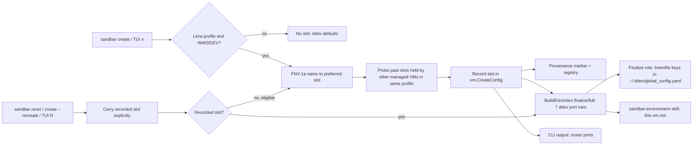
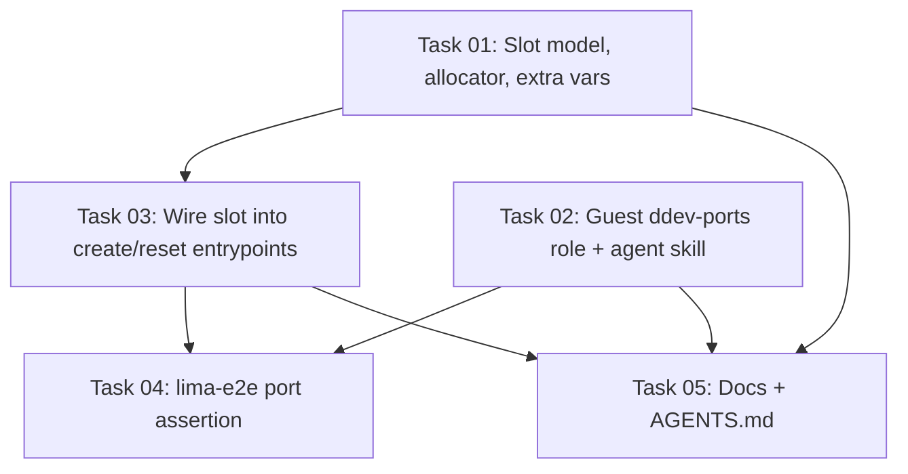

# Plan: Per-VM ddev Port Allocation for Lima VMs

## Original Work Order

> Per-VM ddev port allocation to stop port conflicts between sand VMs.
>
> Problem: Lima auto-forwards every guest listening TCP port to host 127.0.0.1 on the same port (sand inherits this; internal/provider/local.go ForwardArgv comment). Every VM runs its own ddev router on 80/443 (plus mailpit 8025/8026, xhgui 8143/8142), so the first VM wins the host port and later VMs' forwards are silently skipped (only logged in ha.stderr.log). On Linux hosts 80/443 can't be bound unprivileged at all (docs/using-sand/web-servers.md).
>
> Agreed design:
> 1. Allocate each VM a stable port SLOT at create time: hash the VM name to a preferred slot, then linear-probe against the registry (same scope) to avoid collisions (pure hash collides ~4.4% at 10 VMs over 1000 slots, 37% over 100). Persist the slot in vm.CreateConfig so it rides the provenance marker (shared across controllers) and survives reset (reset keeps recorded config).
> 2. Each slot is a block of ports, e.g. base = 20000 + 10*slot: router http +0, https +1, mailpit http +2/https +3, xhgui http +4/https +5.
> 3. Apply in-guest via ddev GLOBAL config during finalize (`ddev config global --router-http-port ... --router-https-port ... --mailpit-http-port ...` etc.), NOT via Lima portForwards remapping — so the URL is identical inside and outside the guest (redirects, ddev describe, Drupal base URLs stay consistent), and it also fixes remote-Lima (stable port for the documented ssh -L recipe) and the Linux privileged-port issue. Proxmox (own IP) can skip or keep defaults.
>
> Open decisions to capture: macOS users lose bare https://proj.ddev.site (URL gains :port) — consider surfacing the URL on the tile/Landing and an opt-out (e.g. --ddev-ports=default); per-project .ddev/config.yaml router_http_port overrides the global (warn?); configurable port range to avoid host-service collisions; only when toolset_ddev is enabled; backfill for existing VMs on reset. Docs update for docs/using-sand/web-servers.md.

## Plan Clarifications

| Question | Answer | Source |
| --- | --- | --- |
| How are existing VMs (no recorded slot) handled? | They keep ddev's default ports until their next reset; a reset of a VM with no recorded slot allocates and records one. No other migration. | user |
| Is there an opt-out that keeps 80/443 for a VM? | No. Keeping sandbar VMs off 80/443 entirely is the point: a macOS user running ddev natively on the host keeps 80/443 with no conflict from any sandbar VM. | user |
| Is the port range user-configurable? | No. Base, stride and slot count are fixed constants. | user |
| Do Proxmox VMs get a port block? | No. Lima only (local and remote-ssh). Proxmox guests have their own address and keep ddev's defaults. | user |
| Where are the assigned ports shown? | In the docs, in `sandbar create`/`sandbar reset` output, and in the guest's `sandbar-environment` agent skill so agents in the VM can state the right URLs proactively. No TUI tile change. | user |
| Backwards compatibility? | Only as stated above: old records without a slot keep working unchanged until reset. | user |
| ddev's router also listens on `traefik_monitor_port` (global-only, default 10999). Should the slot move it too? | Yes, at slot offset +6. A slot is seven ports; +7..+9 stay reserved. Without it every VM forwards 10999 and competes with the others and with a host-native ddev. | user (refinement 2026-11-04) |
| `ddev config global` has no flags for `xhgui_http_port`/`xhgui_https_port`. How does finalize write the ports? | Edit the top-level keys of `~/.ddev/global_config.yaml` directly, one `lineinfile` per key, creating the file if absent. One mechanism for all seven keys, idempotent by construction, needs neither the ddev binary nor Docker. | user (refinement 2026-11-04) |
| Should CI assert the ports reach the guest? | Yes. The `lima-e2e` job (whose VM is ddev-enabled by default) reads `~/.ddev/global_config.yaml` and the skill's `this-vm.md` in the guest and checks they carry the VM's recorded slot ports. No Docker or ddev project start. | user (refinement 2026-11-04) |
| Where does the finalize task live? | A small new role that runs in finalize/full. `roles/dev-tools` is skipped in finalize (`site.yml`: `when: provision_phase != 'finalize'`), so a task there would never run on a clone. | auto-resolved (site.yml) |
| What guards the finalize task? | The presence of the port vars. `toolset_ddev` is emitted only in the base phase (`internal/provision/vars.go`), so in finalize it is just the role default `true` and cannot gate anything. Go emits the port vars only for a Lima backend with `WithDDEV` and a recorded slot. | auto-resolved (vars.go) |
| Does "reset reuses the recorded configuration" carry a new `CreateConfig` field automatically? | No. CLI reset (`resetConfigFromRecord`) and `create --recreate` start from `DefaultCreateConfig()` and copy fields via `adoptRecordedConfig`; the TUI reset (`buildConfig`) replays fields captured in `openResetForm`. Each must carry the slot explicitly. `--from-backup` decodes the whole config from `reset.json`, so it carries the slot once the field is serialized. | auto-resolved (cmd/sandbar/create.go, reset.go, internal/ui/form.go) |
| Which hash picks the preferred slot? | FNV-1a 32-bit from the standard library (`hash/fnv`), pinned so the same name prefers the same slot across releases. | assumption (any stable stdlib hash works; pinning one avoids drift) |

## Executive Summary

Lima forwards every TCP port a guest listens on to the same port on `127.0.0.1` of the Lima host. Every sandbar VM with ddev runs its own ddev router on 80/443, plus Mailpit, XHGui and Traefik-monitor ports, so only the first VM to bind those ports on the host is reachable; later VMs' forwards fail silently. On Linux hosts the privileged ports are not forwarded at all.

This plan gives each Lima-backed, ddev-enabled VM a stable **port slot** of seven ports, chosen once: the VM name is hashed to a preferred slot, then probed forward past slots already held by other managed VMs in the same connection profile. The slot is recorded in the VM's `vm.CreateConfig`, so it travels in the provenance marker (seen by every controller) and is carried explicitly through every reset path. Finalize writes the slot's ports into the guest's ddev **global** configuration file, so ddev itself knows its ports and every URL — `ddev describe`, redirects, application-generated absolute URLs — is identical inside the guest and in the workstation browser.

Changing ddev's ports, rather than remapping them with Lima `portForwards` rules, keeps one URL valid on both sides of the forward. It works unchanged for remote Lima, giving the documented `ssh -L` recipe a stable port. It also moves every port above 1024, which removes the Linux privileged-port limitation. Keeping all sandbar VMs off ddev's default ports (including Traefik's 10999) leaves them free for a host-native ddev. A cheap `lima-e2e` assertion proves the recorded ports actually reach the guest.

## Context

### Current State vs Target State

| Current State | Target State | Why? |
| --- | --- | --- |
| Every ddev VM's router listens on 80/443; only the first VM is reachable from the host, others fail silently | Each ddev VM uses its own block of high ports; all are reachable simultaneously | Running several projects side by side is the core use case for multiple VMs |
| On Linux hosts ddev URLs need a sysctl change or manual `ddev config global` | High ports work unprivileged on every host | Removes a documented manual workaround |
| A host-native ddev on macOS competes with sandbar VMs for 80/443, 8025/8026, 8142/8143 and 10999 | Sandbar VMs created or reset after this change use none of those ports | Host-native ddev keeps working unchanged |
| No record of which ports a VM uses | Slot recorded in `vm.CreateConfig` / provenance marker; stable across reset and across controllers | Bookmarks and `ssh -L` tunnels keep working; two controllers do not hand out conflicting ports |
| Agents in the guest give generic port advice | `sandbar-environment` skill states this VM's ddev ports and URL form | Agents can tell the user the exact URL to open |
| Users must discover ports themselves | `sandbar create`/`sandbar reset` print the router ports | Immediately actionable output |

### Background

- Lima's same-port loopback forwarding is documented in `internal/provider/local.go` (`ForwardArgv` comment) and `docs/using-sand/web-servers.md`. Sandbar deliberately inherits it; this plan does not change Lima forwarding.
- ddev's router is one per Docker host — that is, one per VM — so ddev's *global* configuration (`~/.ddev/global_config.yaml`) is the right granularity. The relevant keys, all valid in the global file: `router_http_port` (default 80), `router_https_port` (443), `mailpit_http_port` (8025), `mailpit_https_port` (8026), `xhgui_http_port` (8143), `xhgui_https_port` (8142), and `traefik_monitor_port` (10999, global-only). `ddev config global` exposes flags for all but the two XHGui keys, which is why finalize edits the file directly (see Plan Clarifications).
- A project's own `.ddev/config.yaml` may set its own router, Mailpit or XHGui ports, which override the global ones. This plan does not detect or warn about that; it is a documented caveat.
- `WithDDEV` lives on `vm.CreateConfig` and is a *shared base* selection: `BuildExtraVars` emits `toolset_ddev` for the **base phase only**. Finalize never receives it, so finalize-side logic cannot gate on it.
- `site.yml` skips `roles/dev-tools` in finalize; `mkcert-ca`, the agent roles, `agent-context` and `project` run in finalize/full.
- The 0.17.0 `agent-context` role installs the `sandbar-environment` skill for all four agents. Its `references/this-vm.md.j2` is templated per VM (`sandbar_vm_name`, `sandbar_profile_type`) and `references/ports.md` describes reaching guest ports per profile type (currently advising a manual move to 8080/8443 on Linux). Both are re-rendered on every finalize.
- Every reset path rebuilds `vm.CreateConfig` field by field rather than reusing the record wholesale: `adoptRecordedConfig` (`cmd/sandbar/create.go`, shared by `sandbar reset` and `sandbar create --recreate`) and the TUI's reset replay (`openResetForm` → `buildConfig` in `internal/ui/form.go`). A new field is dropped by all three unless each copies it. `sandbar reset --from-backup` decodes the full config from `reset.json`.
- Collision odds for a plain hash (computed, not estimated): with 1000 slots, 1% at 5 VMs and 4.4% at 10; with 100 slots, 37% at 10. A plain hash is therefore insufficient on its own; probing against recorded slots is required.
- Golden templates (`sandbar template snapshot`) capture a guest's home, including its ddev global config. A template-sourced create builds its config from flags, not the template record, and still runs finalize (`createVM`), so finalize's write gives the clone its own slot's ports, not the template source's.
- Whole-home preservation restores `~/.ddev` *before* finalize (`internal/provision/preserve.go` ordering), so finalize's write wins and a reset never resurrects stale ports.
- The `Provenancer.Provenance(ctx)` seam already returns every marker for a profile in one call, so allocation can read held slots without new host I/O plumbing.

## Architectural Approach

### Slot model and allocation

**Objective**: Choose, once per VM, a port block that no other managed VM on the same Lima host uses, deterministically enough that the same name tends to land on the same ports.

- Fixed constants in Go: base port 20000, stride 10 ports per slot, 1000 slots (ports 20000–29999). Offsets within a slot: router HTTP +0, router HTTPS +1, Mailpit HTTP +2, Mailpit HTTPS +3, XHGui HTTP +4, XHGui HTTPS +5, Traefik monitor +6; +7..+9 are unused and reserved. *(Traefik offset: see Plan Clarifications.)*
- The preferred slot is FNV-1a 32-bit (`hash/fnv`) of the VM name modulo the slot count. No new dependency.
- The probe walks forward from the preferred slot, wrapping, until it finds a slot not held by any **other** managed VM in the **same connection profile** (scope). The VM being created or reset is excluded from the held set by name, so a VM never collides with its own previous record. The held set comes from the profile's provenance markers (the ownership authority, via `Provenancer.Provenance`), with the registry as fallback where markers are unavailable — the same fallback order other ownership decisions already use. Template records do not hold slots. If every slot is taken, allocation fails with a clear error (not reachable with the design's 1–10 VMs, but it must not loop).
- The slot is stored as a new field on `vm.CreateConfig`. The zero value must mean "no slot recorded" so that every existing registry entry, marker and `reset.json` decodes unchanged; the encoding must make slot 0 distinguishable from "absent".
- Allocation applies only when the target provider is local or remote Lima **and** `WithDDEV` is true. Proxmox VMs never get a slot.
- Allocation is pure computation over data already gathered for create/reset; it must not add guest contact or I/O to the form-submit path (keep it out of `ValidateName`-style synchronous validation).
- The allocation logic belongs in shared create/reset code (`internal/manage` or a small helper it uses) so the CLI and TUI cannot drift.

### Reset behaviour

**Objective**: Keep a VM's ports stable across resets, and give existing VMs a slot the first time they are reset.

- The slot must be **carried explicitly** through every reset path, because none of them reuses the recorded config wholesale *(see Plan Clarifications)*:
  - `adoptRecordedConfig` copies the recorded slot. This covers `sandbar reset` (`resetConfigFromRecord`) and `sandbar create --recreate`.
  - The TUI's `openResetForm` captures the recorded slot and `buildConfig` replays it in reset mode, beside the tool-set replay.
  - `sandbar reset --from-backup` gets it from the manifest's config with no extra work, once the field is serialized.
- A recorded slot is kept as-is (no re-probe), even if another VM has since claimed the same slot.
- If the record has no slot and the VM is eligible (Lima, `WithDDEV`), the reset allocates one through the same allocation path (excluding itself) and records it on success.
- Each entrypoint has a test proving a recorded slot survives: CLI reset, `create --recreate`, TUI reset, and a `reset.json` round-trip.

### Guest configuration in finalize

**Objective**: Make ddev inside the VM listen on the slot's ports, so the same URL works in the guest and on the workstation.

- `BuildExtraVars` emits the seven port values for finalize/full phases only when the backend is Lima, `WithDDEV` is true and a slot is recorded; otherwise it emits none. The base phase never receives them: they are per-VM and must not enter the base version stamp.
- A small new role (for example `roles/ddev-ports`), listed in `site.yml` to run when `provision_phase != 'base'`, sets each key in the guest user's `~/.ddev/global_config.yaml` with one `ansible.builtin.lineinfile` per top-level key (`regexp: '^<key>:'`, `create: true`, owned by the guest user, `~/.ddev` created if absent). *(Write mechanism and role placement: see Plan Clarifications.)*
- The role is guarded by the presence of the port vars, not by `toolset_ddev`. It is idempotent by construction (reports `changed` only when a value differs) and needs neither the ddev binary nor Docker.
- `roles/` is a single `go:embed` entry, so a new role needs no change to the embed set or the rsync filter.
- When no port vars are present, nothing is written, so existing VMs and Proxmox VMs keep ddev defaults.
- A reset overwrites any hand-set ports in the global file (for example the 8080/8443 Linux workaround the docs used to recommend). This is intended and documented.

### Agent-facing context

**Objective**: Let agents inside the VM state the exact ddev URLs without guessing.

- `roles/agent-context/templates/references/this-vm.md.j2` lists the VM's ddev router HTTP/HTTPS ports (and Mailpit, XHGui) when they are set, and the resulting URL form (`https://<project>.ddev.site:<https-port>`).
- `roles/agent-context/files/references/ports.md` replaces the "move the router to 8080/8443" advice with the per-VM ports from `this-vm.md`, and adjusts the `remote-ssh` tunnel example to use them.
- `SKILL.md`'s description and index should mention ddev URLs/ports so the skill triggers for them.

### CLI output

**Objective**: Tell the user the ports at the moment they matter.

- After a successful `sandbar create` or `sandbar reset` of a VM with a slot, print a short line naming the router HTTP and HTTPS ports and the URL form. No TUI tile, form or golden change.

### CI assertion

**Objective**: Prove the recorded ports reach the guest, per AGENTS.md's rule that an assertion must reach the boundary the user cares about.

- In `.github/workflows/test.yml`'s `lima-e2e` job, after the existing create, read the guest's `~/.ddev/global_config.yaml` and `~/.agents/skills/sandbar-environment/references/this-vm.md`. Check that both carry the ports derived from the VM's recorded slot (from the marker/registry or the printed create output). No Docker or ddev project start.

## Risk Considerations and Mitigation Strategies

Technical Risks

- **Slot encoding confuses slot 0 with "absent"**: old records would all look like slot 0, or slot 0 could never be assigned.
    - **Mitigation**: Use an encoding with an explicit absent state (for example a pointer or an offset-by-one value) and test decoding of a pre-existing registry entry, marker and `reset.json`.
- **A reset silently drops the slot** because a reset path rebuilds the config field by field.
    - **Mitigation**: Carry the slot explicitly in `adoptRecordedConfig` and the TUI reset replay; exclude the VM itself from the held set; per-entrypoint tests (see Reset behaviour).
- **Two controllers create VMs on the same remote Lima host at once** and both pick the same free slot.
    - **Mitigation**: Accepted residual risk at the design's 1–10 VM scale; probing is against markers, which the in-flight `provisioning:true` marker makes visible early. Document that the symptom is the same "second VM unreachable".
- **Two profiles or OS users share one Lima host's loopback without seeing each other's markers** (different Lima homes or users on the same machine). Both forward to the same `127.0.0.1`, but neither probes against the other.
    - **Mitigation**: Accepted residual risk; documented in `web-servers.md`.
- **A host service already uses a port in 20000–29999.**
    - **Mitigation**: Accepted (fixed range by decision). Documented in `web-servers.md`.
- **ddev renames or drops a global key, or a direct file edit diverges from what ddev expects.**
    - **Mitigation**: Keys were checked against the current ddev configuration reference during refinement. Re-verify against the ddev version the base image installs during implementation. The `lima-e2e` assertion checks the file; the manual self-validation checks `ddev describe` URLs.

Implementation Risks

- **CLI and TUI drift** (one path allocates or carries the slot, the other does not).
    - **Mitigation**: Allocation lives only in shared create/reset code used by both; tests cover each entrypoint.
- **The finalize task never runs** because it was placed in a role skipped in finalize, or gated on a var finalize never receives.
    - **Mitigation**: Dedicated role run when `provision_phase != 'base'`, guarded on the port vars; the `lima-e2e` assertion fails if the file is not written.
- **Per-VM vars leak into the base stamp**, churning base rebuilds.
    - **Mitigation**: Emit them only for finalize/full and add a test asserting the base phase omits them.
- **Project-level `.ddev/config.yaml` router ports override the global ones**, so a VM appears to ignore its slot.
    - **Mitigation**: Documented caveat in `web-servers.md` and `ports.md`; no detection by decision.

## Success Criteria

### Primary Success Criteria

1. Two ddev-enabled VMs on the same local Lima host, each running a ddev project, are both reachable from the workstation at the same time on their own `https://<project>.ddev.site:<port>` URLs.
2. A newly created ddev-enabled Lima VM records a slot; resetting it through `sandbar reset`, `sandbar create --recreate`, the TUI's `R`, or `--from-backup` keeps the same slot and ports.
3. Resetting a pre-existing VM with no recorded slot allocates and records one; no existing record fails to load.
4. Proxmox VMs and VMs without ddev get no slot and no ddev port configuration.
5. No sandbar VM created or reset after this change has ddev on 80, 443, 8025, 8026, 8142, 8143 or 10999.
6. Inside the guest, `this-vm.md` in the `sandbar-environment` skill states the VM's ddev ports, and `ddev describe` shows URLs with those ports.
7. The `lima-e2e` job asserts the guest's `global_config.yaml` and `this-vm.md` carry the VM's recorded slot ports.
8. `gofmt -l .` is empty, `go vet ./...` and `go test ./...` pass, and the coverage floor holds.

## Self Validation

1. Run `go test ./...`, `go vet ./...` and `gofmt -l .`; confirm success and empty gofmt output.
2. Run the allocation unit tests and confirm they cover: deterministic preferred slot for a fixed name; probing past a held slot; self-exclusion on reset; wrap-around; exhaustion error; slot 0 vs absent; Proxmox and `WithDDEV=false` yield no slot.
3. Run the reset-path tests and confirm a recorded slot survives `resetConfigFromRecord`, `create --recreate` (`adoptRecordedConfig`), the TUI reset's `buildConfig`, and a `reset.json` write/read round-trip.
4. Decode a registry file, a provenance marker and a `reset.json` written by the previous release (fixtures) and confirm the slot reads as absent and nothing else changes.
5. Inspect `BuildExtraVars` output for base, finalize and full phases, with and without a slot, and for a Proxmox backend; confirm the seven port vars appear only in finalize/full, for Lima, with a slot.
6. Run `ansible-playbook --syntax-check` (the `lint` job's checks) and the Python unit tests under `tests/`.
7. On this KVM host, with Lima: create two ddev-enabled VMs (`sandbar create`), confirm each prints different router ports. In each, `cat ~/.ddev/global_config.yaml` and confirm all seven slot ports. Start a ddev project in each and `curl -sk https://<project>.ddev.site:<https-port>` from the host for both, confirming both respond simultaneously; run `ddev describe` in one and confirm its URLs carry the slot ports.
8. In one VM, `cat ~/.agents/skills/sandbar-environment/references/this-vm.md` and confirm it lists that VM's ports.
9. `sandbar reset` one VM and confirm the printed ports match the ones printed at create; repeat with the TUI's `R` and confirm `global_config.yaml` is unchanged.
10. Dispatch `test.yml` on the branch (`gh workflow run test.yml --ref <branch>`) and confirm the `lima-e2e` port assertion passes.
11. Run `uvx --with-requirements docs/requirements.txt mkdocs build --strict` and confirm it passes.

## Documentation

Yes — this plan changes documentation and AGENTS.md:

- `docs/using-sand/web-servers.md`: replace the macOS "bare URL just works" and Linux workaround text with the per-VM port scheme, how to find a VM's ports, the project-level override caveat, the fixed 20000–29999 range, the shared-loopback caveat for several users or Lima homes on one host, that a reset replaces hand-set global ports, and an updated `ssh -L` example for remote Lima. State that Proxmox is unchanged.
- `roles/agent-context` skill references (`this-vm.md.j2`, `ports.md`, `SKILL.md` description) as described above.
- `docs/using-sand/cli-reference.md` if it documents create/reset output.
- `AGENTS.md`: a short entry recording the invariants:
  - ports are changed in ddev's global config file, not via Lima remapping, and why;
  - the file is edited per key because `ddev config global` cannot set XHGui ports;
  - the finalize role is guarded on the port vars, because `toolset_ddev` is base-only;
  - Lima-only and `WithDDEV`-only;
  - the slot is stored in `vm.CreateConfig` with an explicit absent state, and must be carried explicitly by every reset path;
  - allocation lives in shared create/reset code and excludes the VM itself;
  - per-VM vars never enter the base stamp;
  - there is no opt-out by design, to keep ddev's default ports free for host-native ddev.

## Resource Requirements

### Development Skills

- Go (sandbar's `vm`, `manage`, `provision`, `provider`, `ui` packages), Ansible role authoring, familiarity with ddev global configuration and Lima port forwarding.

### Technical Infrastructure

- Existing toolchain only: Go, Ansible, ddev in the base image, Lima with KVM for the end-to-end check. No new module dependencies (`hash/fnv` is standard library).

## Notes

- Deliberately out of scope: a TUI tile display of ports, an opt-out flag, a configurable range, detection of project-level port overrides, and any Proxmox change.
- The user's main checkout was behind `origin/main` when this plan was drafted; the plan is written against `origin/main` at 0.17.0+ (`618dbf1`).

### Change Log

- 2026-11-04: Refinement.
  - Added the Traefik monitor port (+6) to the slot.
  - Switched the guest write from `ddev config global` to per-key `lineinfile`, because there are no XHGui flags.
  - Moved the finalize task out of `roles/dev-tools`, which is skipped in finalize, into a new role guarded on the port vars rather than base-only `toolset_ddev`.
  - Required every reset path to carry the slot explicitly, with self-exclusion in the probe.
  - Added a `lima-e2e` guest assertion.
  - Scoped success criterion 5 to VMs created or reset after the change.
  - Pinned the hash to FNV-1a.
  - Recorded the shared-loopback and overwritten-hand-set-ports risks.
  - Renamed `sand` commands to `sandbar`.

## Task Dependencies

## Execution Blueprint

**Validation Gates:**
- Reference: `.ai/strikethroo/config/hooks/POST_PHASE.md`

### ✅ Phase 1: Core model and guest configuration
**Parallel Tasks:**
- ✔️ Task 01: Slot model, allocator and finalize extra vars
- ✔️ Task 02: Guest ddev-ports role and sandbar-environment skill references

### ✅ Phase 2: Entrypoint wiring
**Parallel Tasks:**
- ✔️ Task 03: Allocate and carry the slot through every create/reset entrypoint (depends on: 01)

### Phase 3: CI assertion and documentation
**Parallel Tasks:**
- Task 04: lima-e2e assertion that the recorded ports reach the guest (depends on: 02, 03)
- Task 05: Documentation and AGENTS.md (depends on: 01, 02, 03)

### Post-phase Actions

### Execution Summary
- Total Phases: 3
- Total Tasks: 5
