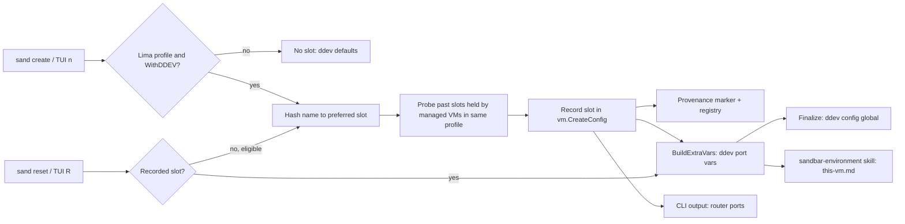

# Plan: Per-VM ddev Port Allocation for Lima VMs

## Original Work Order

> Per-VM ddev port allocation to stop port conflicts between sand VMs.
>
> Problem: Lima auto-forwards every guest listening TCP port to host 127.0.0.1 on the same port (sand inherits this; internal/provider/local.go ForwardArgv comment). Every VM runs its own ddev router on 80/443 (plus mailpit 8025/8026, xhgui 8143/8142), so the first VM wins the host port and later VMs' forwards are silently skipped (only logged in ha.stderr.log). On Linux hosts 80/443 can't be bound unprivileged at all (docs/using-sand/web-servers.md).
>
> Agreed design:
> 1. Allocate each VM a stable port SLOT at create time: hash the VM name to a preferred slot, then linear-probe against the registry (same scope) to avoid collisions (pure hash collides ~4.4% at 10 VMs over 1000 slots, 37% over 100). Persist the slot in vm.CreateConfig so it rides the provenance marker (shared across controllers) and survives reset (reset keeps recorded config).
> 2. Each slot is a block of ports, e.g. base = 20000 + 10*slot: router http +0, https +1, mailpit http +2/https +3, xhgui http +4/https +5.
> 3. Apply in-guest via ddev GLOBAL config during finalize (`ddev config global --router-http-port ... --router-https-port ... --mailpit-http-port ...` etc.), NOT via Lima portForwards remapping — so the URL is identical inside and outside the guest (redirects, ddev describe, Drupal base URLs stay consistent), and it also fixes remote-Lima (stable port for the documented ssh -L recipe) and the Linux privileged-port issue. Proxmox (own IP) can skip or keep defaults.
>
> Open decisions to capture: macOS users lose bare https://proj.ddev.site (URL gains :port) — consider surfacing the URL on the tile/Landing and an opt-out (e.g. --ddev-ports=default); per-project .ddev/config.yaml router_http_port overrides the global (warn?); configurable port range to avoid host-service collisions; only when toolset_ddev is enabled; backfill for existing VMs on reset. Docs update for docs/using-sand/web-servers.md.

## Plan Clarifications

| Question | Answer |
| --- | --- |
| How are existing VMs (no recorded slot) handled? | They keep ddev's default ports until their next reset; a reset of a VM with no recorded slot allocates and records one. No other migration. |
| Is there an opt-out that keeps 80/443 for a VM? | No. Keeping sand VMs off 80/443 entirely is the point: a macOS user running ddev natively on the host keeps 80/443 with no conflict from any sand VM. |
| Is the port range user-configurable? | No. Base, stride and slot count are fixed constants. |
| Do Proxmox VMs get a port block? | No. Lima only (local and remote-ssh). Proxmox guests have their own address and keep ddev's defaults. |
| Where are the assigned ports shown? | In the docs, in `sand create`/`sand reset` output, and in the guest's `sandbar-environment` agent skill so agents in the VM can state the right URLs proactively. No TUI tile change. |
| Backwards compatibility? | Only as stated above: old records without a slot keep working unchanged until reset. |

## Executive Summary

Lima forwards every TCP port a guest listens on to the same port on `127.0.0.1` of the Lima host. Every sand VM with ddev runs its own ddev router on 80/443 (plus Mailpit and XHGui ports), so only the first VM to bind those ports on the host is reachable; later VMs' forwards fail silently. On Linux hosts the privileged ports are not forwarded at all.

This plan gives each Lima-backed, ddev-enabled VM a stable **port slot**, chosen once at create time: the VM name is hashed to a preferred slot, then probed forward past slots already held by other managed VMs in the same connection profile. The slot is recorded in the VM's `vm.CreateConfig`, so it travels in the provenance marker (seen by every controller) and survives resets, which reuse the recorded configuration. Finalize writes the slot's six ports into the guest's ddev **global** configuration, so ddev itself knows its ports and every URL — `ddev describe`, redirects, application-generated absolute URLs — is identical inside the guest and in the workstation browser.

Changing ddev's ports, rather than remapping them with Lima `portForwards` rules, was chosen because it keeps one URL valid on both sides of the forward, works unchanged for remote Lima (giving the documented `ssh -L` recipe a stable port), and moves every port above 1024, which removes the Linux privileged-port limitation. Keeping all sand VMs off 80/443 also frees those ports for a host-native ddev.

## Context

### Current State vs Target State

| Current State | Target State | Why? |
| --- | --- | --- |
| Every ddev VM's router listens on 80/443; only the first VM is reachable from the host, others fail silently | Each ddev VM uses its own block of high ports; all are reachable simultaneously | Running several projects side by side is the core use case for multiple VMs |
| On Linux hosts ddev URLs need a sysctl change or manual `ddev config global` | High ports work unprivileged on every host | Removes a documented manual workaround |
| A host-native ddev on macOS competes with sand VMs for 80/443 | Sand VMs never use 80/443, 8025/8026 or 8142/8143 | Host-native ddev keeps working unchanged |
| No record of which ports a VM uses | Slot recorded in `vm.CreateConfig` / provenance marker; stable across reset and across controllers | Bookmarks and `ssh -L` tunnels keep working; two controllers cannot hand out conflicting ports |
| Agents in the guest give generic port advice | `sandbar-environment` skill states this VM's ddev ports and URL form | Agents can tell the user the exact URL to open |
| Users must discover ports themselves | `sand create`/`sand reset` print the router ports | Immediately actionable output |

### Background

- Lima's same-port loopback forwarding is documented in `internal/provider/local.go` (`ForwardArgv` comment) and `docs/using-sand/web-servers.md`. Sand deliberately inherits it; this plan does not change Lima forwarding.
- ddev's router is one per Docker host — that is, one per VM — so ddev's *global* configuration (`~/.ddev/global_config.yaml`, written by `ddev config global`) is the right granularity. The relevant settings are router HTTP/HTTPS, Mailpit HTTP/HTTPS and XHGui HTTP/HTTPS ports.
- A project's own `.ddev/config.yaml` may set its own router ports, which override the global ones. This plan does not detect or warn about that; it is a documented caveat.
- `WithDDEV` lives on `vm.CreateConfig` and becomes the `toolset_ddev` extra var in `internal/provision/vars.go`. Allocation and the ddev configuration happen only when it is true.
- The 0.17.0 `agent-context` role installs the `sandbar-environment` skill for all four agents. Its `references/this-vm.md.j2` is templated per VM (`sandbar_vm_name`, `sandbar_profile_type`) and `references/ports.md` describes reaching guest ports per profile type. Both are re-rendered on every finalize.
- Collision odds for a plain hash (computed, not estimated): with 1000 slots, 1% at 5 VMs and 4.4% at 10; with 100 slots, 37% at 10. A plain hash is therefore insufficient on its own; probing against recorded slots is required.
- Golden templates (`sand template snapshot`) capture a guest's home, including its ddev global config. Because finalize rewrites the ddev global config on every clone, a VM created from a template ends up with its own slot's ports, not the template source's.
- Whole-home preservation restores `~/.ddev` *before* finalize (`internal/provision/preserve.go` ordering), so finalize's write wins and a reset never resurrects stale ports.

## Architectural Approach

### Slot model and allocation

**Objective**: Choose, once per VM, a port block that no other managed VM on the same Lima host uses, deterministically enough that the same name tends to land on the same ports.

- Fixed constants in Go: base port 20000, stride 10 ports per slot, 1000 slots (ports 20000–29999). Offsets within a slot: router HTTP +0, router HTTPS +1, Mailpit HTTP +2, Mailpit HTTPS +3, XHGui HTTP +4, XHGui HTTPS +5; +6..+9 are unused and reserved.
- The preferred slot is a stable hash of the VM name (a standard-library hash, no new dependency) modulo the slot count.
- The probe walks forward from the preferred slot, wrapping, until it finds a slot not held by any other managed VM in the **same connection profile** (scope). The held set comes from the profile's provenance markers (the ownership authority), with the registry as fallback where markers are unavailable — the same fallback order other ownership decisions already use. If every slot is taken, create fails with a clear error (not reachable with the design's 1–10 VMs, but must not loop).
- The slot is stored as a new field on `vm.CreateConfig`. The zero value must mean "no slot recorded" so that every existing registry entry and marker decodes unchanged; the encoding must make slot 0 distinguishable from "absent".
- Allocation applies only when the target provider is local or remote Lima **and** `WithDDEV` is true. Proxmox VMs never get a slot.
- Allocation is pure computation over data already gathered for create/reset; it must not add guest contact or I/O to the form-submit path (keep it out of `ValidateName`-style synchronous validation).
- The allocation logic belongs in shared create/reset code (`internal/manage` or a small helper it uses) so the CLI and TUI cannot drift.

### Reset behaviour

**Objective**: Keep a VM's ports stable across resets, and give existing VMs a slot the first time they are reset.

- A reset reuses the recorded configuration, including the slot. If the recorded slot is present, it is kept as-is (no re-probe).
- If the record has no slot and the VM is eligible (Lima, `WithDDEV`), the reset allocates one through the same allocation path and records it on success.
- `sand reset --from-backup` takes its configuration from the reset manifest; a slot present there is reused, and an absent one is allocated as above.

### Guest configuration in finalize

**Objective**: Make ddev inside the VM listen on the slot's ports, so the same URL works in the guest and on the workstation.

- `BuildExtraVars` emits the six port values (or nothing when no slot is recorded) for finalize/full phases.
- An Ansible task in the existing ddev setup (`roles/dev-tools`) applies them as the guest user with `ddev config global`, guarded by `toolset_ddev` and the presence of the port vars. It must be idempotent (report `changed` only when the stored values differ) and must not require Docker to be running.
- When no slot vars are present, nothing is written, so existing VMs and Proxmox VMs keep ddev defaults.
- The base phase must not receive these vars: they are per-VM and must not enter the base version stamp.

### Agent-facing context

**Objective**: Let agents inside the VM state the exact ddev URLs without guessing.

- `roles/agent-context/templates/references/this-vm.md.j2` lists the VM's ddev router HTTP/HTTPS ports (and Mailpit/XHGui) when they are set, and the resulting URL form (`https://<project>.ddev.site:<https-port>`).
- `roles/agent-context/files/references/ports.md` replaces the "move the router to 8080/8443" advice with the per-VM ports from `this-vm.md`, and adjusts the `remote-ssh` tunnel example to use them.
- `SKILL.md`'s description and index should mention ddev URLs/ports so the skill triggers for them.

### CLI output

**Objective**: Tell the user the ports at the moment they matter.

- After a successful `sand create` or `sand reset` of a VM with a slot, print a short line naming the router HTTP and HTTPS ports and the URL form. No TUI tile, form or golden change.

## Risk Considerations and Mitigation Strategies

Technical Risks

- **Slot encoding confuses slot 0 with "absent"**: old records would all look like slot 0, or slot 0 could never be assigned.
    - **Mitigation**: Use an encoding with an explicit absent state (for example a pointer or an offset-by-one value) and test decoding of a pre-existing registry entry and marker.
- **Two controllers create VMs on the same remote Lima host at once** and both pick the same free slot.
    - **Mitigation**: Accepted residual risk at the design's 1–10 VM scale; probing is against markers, which the in-flight `provisioning:true` marker makes visible early. Document that the symptom is the same "second VM unreachable" and that a reset of one VM re-probes only if its slot is cleared — out of scope to automate.
- **A host service already uses a port in 20000–29999.**
    - **Mitigation**: Accepted (fixed range by decision). Documented in `web-servers.md`.
- **`ddev config global` flag names or behaviour differ across ddev versions.**
    - **Mitigation**: Verify the flags against the ddev version the base image installs during implementation; assert the resulting `global_config.yaml` values in the e2e check.

Implementation Risks

- **CLI and TUI drift** (one path allocates, the other does not).
    - **Mitigation**: Allocation lives only in shared create/reset code used by both; tests cover both entrypoints.
- **Per-VM vars leak into the base stamp**, churning base rebuilds.
    - **Mitigation**: Emit them only for finalize/full and add a test asserting the base phase omits them.
- **Project-level `.ddev/config.yaml` router ports override the global ones**, so a VM appears to ignore its slot.
    - **Mitigation**: Documented caveat in `web-servers.md` and `ports.md`; no detection by decision.

## Success Criteria

### Primary Success Criteria

1. Two ddev-enabled VMs on the same local Lima host, each running a ddev project, are both reachable from the workstation at the same time on their own `https://<project>.ddev.site:<port>` URLs.
2. A newly created ddev-enabled Lima VM records a slot; resetting it keeps the same slot and ports.
3. Resetting a pre-existing VM with no recorded slot allocates and records one; no existing record fails to load.
4. Proxmox VMs and VMs without ddev get no slot and no ddev port configuration.
5. No sand VM's ddev listens on 80, 443, 8025, 8026, 8142 or 8143 after this change.
6. Inside the guest, `this-vm.md` in the `sandbar-environment` skill states the VM's ddev ports, and `ddev describe` shows URLs with those ports.
7. `gofmt -l .` is empty, `go vet ./...` and `go test ./...` pass, and the coverage floor holds.

## Self Validation

1. Run `go test ./...`, `go vet ./...` and `gofmt -l .`; confirm success and empty gofmt output.
2. Run the allocation unit tests and confirm they cover: deterministic preferred slot for a fixed name; probing past a held slot; wrap-around; exhaustion error; slot 0 vs absent; Proxmox and `WithDDEV=false` yield no slot.
3. Decode a registry file and a provenance marker written by the previous release (fixture) and confirm the slot reads as absent and nothing else changes.
4. Inspect `BuildExtraVars` output for base, finalize and full phases with and without a slot; confirm port vars appear only in finalize/full with a slot.
5. Run `ansible-playbook --syntax-check` (the `lint` job's checks) and the Python unit tests under `tests/`.
6. On this KVM host, with Lima: create two ddev-enabled VMs (`sand create`), confirm each prints different router ports, then in each run `ddev config global` (read-only listing) and `cat ~/.ddev/global_config.yaml` to confirm the slot ports; start a ddev project in each and `curl -sk https://<project>.ddev.site:<https-port>` from the host for both, confirming both respond simultaneously.
7. In one VM, `cat ~/.agents/skills/sandbar-environment/references/this-vm.md` and confirm it lists that VM's ports.
8. `sand reset` one VM and confirm the printed ports match the ones printed at create.
9. Run `uvx --with-requirements docs/requirements.txt mkdocs build --strict` and confirm it passes.

## Documentation

Yes — this plan changes documentation and AGENTS.md:

- `docs/using-sand/web-servers.md`: replace the macOS "bare URL just works" and Linux workaround text with the per-VM port scheme, how to find a VM's ports, the project-level override caveat, the fixed 20000–29999 range, and an updated `ssh -L` example for remote Lima. State that Proxmox is unchanged.
- `roles/agent-context` skill references (`this-vm.md.j2`, `ports.md`, `SKILL.md` description) as described above.
- `docs/using-sand/cli-reference.md` if it documents create/reset output.
- `AGENTS.md`: a short entry recording the invariants — ports are changed in ddev's global config, not via Lima remapping, and why; Lima-only and `WithDDEV`-only; slot stored in `vm.CreateConfig` with an explicit absent state; allocation in shared create/reset code; per-VM vars never enter the base stamp; no opt-out by design, to keep 80/443 free for host-native ddev.

## Resource Requirements

### Development Skills

- Go (sand's `vm`, `manage`, `provision`, `provider` packages), Ansible role authoring, familiarity with ddev global configuration and Lima port forwarding.

### Technical Infrastructure

- Existing toolchain only: Go, Ansible, ddev in the base image, Lima with KVM for the end-to-end check. No new module dependencies.

## Notes

- Deliberately out of scope: a TUI tile display of ports, an opt-out flag, a configurable range, detection of project-level port overrides, and any Proxmox change.
- The user's main checkout was behind `origin/main` when this plan was drafted; the plan is written against `origin/main` at 0.17.0+ (`618dbf1`).
