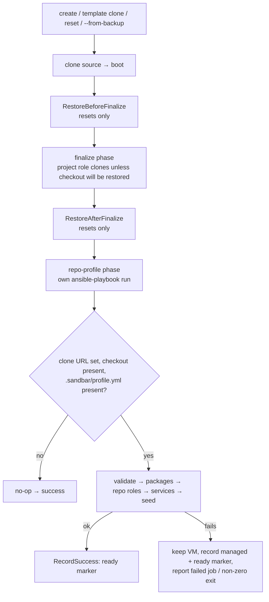

# Plan: Repo-Checked-In Provisioning Profiles (rebuilt on current main)

## Original Work Order

> Repo-checked-in provisioning profiles (.sandbar/), rebuilt on current main. Supersedes PR #68 (archived plan 18), which predates the published base image, per-VM agents, golden templates and the sand→sandbar rename.
>
> Goal: a `.sandbar/` directory committed to a project repository declares what that repo's VM needs beyond the stock base — apt packages, systemd services, Ansible roles shipped in `.sandbar/roles/`, and a seed tasks file run last. `sandbar create --clone-url` discovers and applies it inside the guest, so every teammate gets the same declared configuration. Resources (CPU/memory/disk) stay out of the manifest: they are host-specific.
>
> Carry forward from PR #68 (branch on GitHub, reuse where it still fits):
> - Guest-only design: discovered, validated and applied inside the guest during finalize, after the `project` role clones. No repo content read, parsed or executed on the host; no new host-emitted extra-vars; base image and its stamp untouched.
> - Standalone stdlib Python validator (`scripts/validate_profile.py`) with a good/bad manifest corpus tested in the `unit` job (no VM): unknown keys and malformed values fail finalize with a clear message.
> - `roles/repo-profile` stage: validate → packages → repo roles (read in place, never in the embedded playbook fileset / rsync filter / content hash) → services → seed last. No consent gate (cloning a repo already implies running its code in the guest). Repo tasks must be idempotent.
> - Fixture repo served as a local `git://localhost/<org>/<repo>` remote for a blocking `lima-e2e` full-path test; molecule only as supplementary weekly depth.
> - Docs page disambiguating "provisioning profiles" from Connection Profiles, stating the honest guarantee (identical declared configuration, not byte-identical — apt versions are not pinned).
>
> Drop from PR #68:
> - The "shipped profiles" restructuring of claude/ddev/go/java. DDEV/Go/Java now always ship in the published base image (`--with-ddev/go/java` are deprecated no-ops) and agents install per-VM after clone, so there is no base-tier toolset to restructure. Do not move `roles/claude-code`. Provide example `.sandbar/` profiles in docs/fixtures instead.
> - The base-stamp/toolset-key reasoning (stamp is now `v3:` content-hash only).
>
> Decide/handle in the design:
> 1. Agent requests: either drop the manifest `toolset` group, or limit it to the per-VM agents (claude, codex, opencode, pi) and route it through the existing `toolset_*` / `agent-install` / `agent-context` path rather than a parallel installer. Note interaction with remembered `agent-preferences.json` and recorded per-VM agent choices on reset.
> 2. Reset with a preserved project (BUG in PR #68's design): `internal/provision/provision.go` clears `project_clone_url` in finalize when `plan.Project.RestoresCheckout`, and the checkout is restored only AFTER finalize. A stage gated on `project_clone_url` silently never runs on those resets. The stage must run against the restored checkout (e.g. a post-restore pass, or gating on checkout presence). Must work for both Lima `Reset` and Proxmox `resetInstance` and the `--from-backup` resume path.
> 3. Golden templates: a create from a template re-runs finalize with the clone URL, so the stage re-runs per template clone (cost; idempotency). Template freshness is judged by the source VM's recorded revision (#313) — decide whether a change to `.sandbar/` should mark a template stale, and how that is surfaced.
> 4. Ordering vs current `site.yml`: stage goes after `project`; confirm it does not write the home files `post_tasks` records as sandbar defaults (or a later preserve-home reset misclassifies repo-written content), and consider its position relative to `mkcert-ca` and the agent roles.
> 5. Backends: the stage is guest-side so it should work on local Lima, remote Lima and Proxmox; decide test coverage beyond the Lima e2e.
> 6. Security model docs: repo Ansible runs as root after the clone token `.env` / scoped `GITLAB_TOKEN` are present — state it plainly in `docs/reference/security-model.md`.
> 7. Progress: the tile's task-count denominator (`SAND_ANSIBLE_TASK_TOTAL` via `--list-tasks`) cannot see dynamically included repo tasks — decide acceptable behaviour.
>
> Paths are now `cmd/sandbar`, binary `sandbar`. Follow AGENTS.md conventions (no plan references in commit messages/code comments, coverage floor ratchet, goldens if TUI changes).

## Plan Clarifications

| # | Question | Answer |
|---|----------|--------|
| 1 | May the manifest request coding agents (claude/codex/opencode/pi)? | **No.** Drop the `toolset` group entirely. The manifest declares `packages`, `services`, `roles` and `seed` only. Agent choice stays the user's (flags, TUI, `agent-preferences.json`, recorded per-VM choices). |
| 2 | How does the stage reach a checkout that a reset restores after finalize? | **Its own playbook phase, always.** A separate `repo-profile` phase runs after finalize **and** after `RestoreAfterFinalize`, in every flow: create, template clone, Lima `Reset`, Proxmox `resetInstance`, and `--from-backup` resume. One code path. |
| 3 | Should a change to `.sandbar/` affect golden-template freshness? | **No freshness change.** The phase re-runs on every template clone, so the clone converges to the checkout's current profile. Document this. No host-side knowledge of `.sandbar/`. |
| 4 | Test coverage across backends? | **Lima e2e + fakes.** Blocking `lima-e2e` full-path test (create, and a reset preserving the project). Proxmox and remote-Lima ordering covered by unit tests with fakes. No new Proxmox CI. |
| 5 | Progress display for the new phase? | **Indeterminate.** The phase announces an unknown total; the tile renders an indeterminate state rather than a percentage that reaches 100% early. Small UI change plus golden updates. |
| 6 | What happens to the VM when the phase fails? | **Keep the VM, mark the run failed.** The VM is not purged (base, agents and checkout are intact). The controller that ran it shows a failed job (red tile, log kept); the CLI exits non-zero naming the repo-profile layer. On reset, staged archives are kept per `StageGuard` rules. |
| 7 | Backwards compatibility? | **None required.** PR #68 never merged; no `.sandbar/` format exists in any release. |
| 8 | Scope approval | **Approved** as summarised in this plan. |

## Executive Summary

This plan adds **repo-checked-in provisioning profiles**: a `.sandbar/` directory committed to a project repository that declares the extra apt packages, systemd services, Ansible roles and a final seed tasks file the project's development VM needs. When `sandbar create --clone-url` (CLI or TUI) builds a VM for that repository, sandbar finds the profile inside the guest and applies it, so every teammate gets the same declared configuration from one committed source.

The design keeps PR #68's sound core — guest-only discovery and execution, a strict standalone validator, repo roles read in place, no consent gate — and discards the half that main has overtaken: DDEV, Go and Java are now baked into the published base image, agents are per-VM, and the base stamp is a content hash, so there is no base-tier toolset to restructure. The one structural change from #68 is that the profile runs as its **own playbook phase** after finalize and after post-finalize restores. That fixes a defect in #68's design (a reset preserving the project never ran the profile, because finalize runs without the clone URL and the checkout is restored afterwards) and gives create, template clone, both reset backends and `--from-backup` resume one shared code path.

Expected outcomes: projects can make their VM's extra setup reproducible by committing it; repositories without `.sandbar/` behave exactly as today; a broken profile fails loudly without destroying an otherwise working VM; and the host never reads, parses or executes repository content.

## Context

### Current State vs Target State

| Current State | Target State | Why? |
|---------------|--------------|------|
| A project's extra VM setup (packages, services, bootstrap) is done by hand after create | A committed `.sandbar/profile.yml` declares it and sandbar applies it automatically | Team-wide reproducibility from one source of truth |
| Nothing project-specific runs after the `project` role clones | A `repo-profile` playbook phase validates and applies the profile after finalize and after restores | Projects need packages, services and seed steps to reach a working state |
| Reset preserving the project runs finalize without `project_clone_url` and restores the checkout afterwards | The `repo-profile` phase runs after `RestoreAfterFinalize`, so it sees the restored checkout | A stage inside finalize would silently skip these resets |
| Each playbook run announces an exact task total; the tile shows a percentage | The `repo-profile` phase announces an unknown total and the tile shows an indeterminate state | Dynamically included repo roles/seed tasks are invisible to `--list-tasks`; a bar at 100% while work continues misleads |
| Any provisioning failure on create purges the partial VM | A `repo-profile` failure keeps the VM, records it managed, and reports the failure | The VM is otherwise complete; a repo-authoring mistake should not cost the user the VM |
| No per-repository configuration concept exists | `.sandbar/` is documented, with example profiles and a validator | Foundation for the feature |

### Background

- **PR #68 / plan 18** implemented an earlier version against a July base. Main has since moved more than 300 commits: published multi-arch base images (`UsePublishedBase`), agents installed per-clone (`claude-code`, `codex`, `opencode`, `pi`, `agent-install`, `agent-context`), golden templates (registry v4, freshness from the source VM's recorded revision), Proxmox as a full backend, and the `sand` → `sandbar` rename (`cmd/sandbar`). The PR's validator, role, fixture approach and docs remain reusable as reference material; its shipped-profiles restructuring and toolset/stamp reasoning do not.
- **Reset ordering is fixed by AGENTS.md.** Agent state and whole-home restores happen before finalize; the project and selected checkouts are restored after finalize, with `project_clone_url` omitted so finalize cannot clobber them. Both `Provisioner.Reset` (Lima) and `proxmoxProvider.resetInstance` follow that order. The new phase must slot in after the post-finalize restore in both.
- **`site.yml` `post_tasks`** record the final bytes of `.bashrc`, `.profile`, `.gitconfig` and `.claude/settings.json` on fresh guests as sandbar's baseline, so a later preserve-home reset can tell defaults from user edits. A repo-profile run must not trigger that recording, or repo-written changes to those files would be misclassified as sandbar defaults.
- **Progress parsing** (`internal/ui/ansible.go`): each playbook run's `SAND_ANSIBLE_TASK_TOTAL` marker resets the counter; `Fraction()` returns 0 with no total and clamps at 1. Today there is no indeterminate rendering — a missing total renders as `0%` and `n/0`, which contradicts AGENTS.md's "a metric with no reading renders as an em dash, never as 0".
- **Provenance**: a VM carries an in-flight marker while building and is flipped to ready by `manage.RecordSuccess`. A kept-but-failed VM must not be left with an in-flight marker, or other controllers would show it as Building forever.
- **Terminology**: "profile" already means Connection Profile (`profiles.yaml`), and "seed" is used internally for apt-cache seeding. User-facing text consistently says **provisioning profile**.
- **Honest guarantee**: apt package versions are not pinned, so the promise is identical *declared* configuration, not byte-identical VMs.

## Architectural Approach

### Manifest Schema and Standalone Validator

**Objective**: Define exactly what a repository may declare and reject anything else with a clear message before any change is applied.

The manifest is `.sandbar/profile.yml` with four optional groups:

| Group | Contents |
|-------|----------|
| `packages` | apt package names, installed in one transaction |
| `services` | systemd unit names to enable and start |
| `roles` | names of roles under `.sandbar/roles/` to include, in order |
| `seed` | path, relative to the checkout and confined to `.sandbar/`, of an Ansible tasks file run last |

There is no `toolset`/agent group and no resources. Validation is a self-contained, standard-library-only Python script shipped in the embedded playbook (`scripts/`), invoked in the guest against the cloned manifest. Unknown keys, wrong types, malformed package/unit/role names and seed paths escaping `.sandbar/` are errors that name the offending key. The script reads a restricted, safe YAML subset with no dependency on PyYAML, so the guest needs nothing new. Because it is a discrete artifact with a file in and an exit status plus message out, a Go table test runs the real embedded script against a corpus of valid and deliberately malformed manifests in the `unit` job. Adding the script to the playbook means updating the `go:embed` set, the rsync filter and `playbookFileset` together, guarded by `TestGuestSyncCopiesOnlyThePlaybook`.

### The `repo-profile` Playbook Phase

**Objective**: Apply the profile inside the guest against whatever checkout exists after finalize and restores, without touching the base, the embedded fileset, or the home-file baselines.

`site.yml` gains a `repo-profile` value for `provision_phase`. In that phase every existing role and the `post_tasks` home-default recording are skipped; only the new `repo-profile` role runs. The role:

1. Derives the checkout path from `project_clone_url` the same way the `project` role does (the host passes the VM's real clone URL in this phase even when finalize omitted it — an existing variable, not a new one), and exits as a no-op when there is no clone URL, no checkout directory, or no manifest.
2. Runs the validator and fails with its message on an invalid manifest.
3. Installs declared packages (`install_recommends: false`, refreshing the apt index since this run has not).
4. Includes declared roles from `.sandbar/roles/`, read in place through a roles-path entry that is excluded from the embed set, rsync filter and content hash. The link it creates is scaffolding recreated on every run.
5. Enables and starts declared services.
6. Includes the seed tasks file last. Repo content runs with the play's privileges (root); authors use `become_user` for user-level steps. The phase re-runs on every reset and template clone, so repo tasks must be idempotent.

The base image and its `v3:` stamp are never involved: the phase only ever runs against a work VM, never during image or base builds.

### Host Orchestration Across Flows and Backends

**Objective**: Run the phase at the same point in every flow on every backend, and handle its failure without purging the VM.

A single shared helper in `internal/provision` runs the phase after finalize. It is called:

- by local/remote Lima create and template-clone create, after finalize succeeds;
- by `Provisioner.Reset` and Proxmox `resetInstance`, after `RestoreAfterFinalize`, with the VM's recorded clone URL even when finalize ran without it;
- by the `--from-backup` resume path, which follows the same reset sequence;
- by Proxmox create, after its finalize.

The phase runs outside the create path's partial-VM purge. If it fails, the VM is kept and recorded as managed with a **ready** provenance marker, so it is resettable and deletable and no controller shows it as Building forever. The error is wrapped to name the repo-profile layer (distinct from the transport annotation for exit 255). In the TUI the job is marked failed, so `deriveStatus` renders the tile red with the log one `l` away. In the CLI the command exits non-zero after recording. On a reset, a failure in this phase occurs after the guest was replaced, so `StageGuard` keeps the archives and prints the resume command, as for any post-delete failure. Other controllers see the VM as ready; the failure is visible only to the controller that ran the build (a stated limitation, consistent with run history not being persisted).

`cmd/sandbar`'s `settleSecrets` and the TUI's `provisionDoneMsg` handling must treat this failure identically, per AGENTS.md's CLI/TUI parity rule.

### Indeterminate Progress for the Phase

**Objective**: Show honest progress while unlisted repo tasks run.

The in-guest wrapper announces an explicit unknown total for the `repo-profile` phase instead of a `--list-tasks` count. The parser records "total unknown" distinctly from "not yet announced". The tile then renders the bar row with no fill and an em dash in place of a percentage, and the role line shows the current role/task and the count of tasks started without a denominator. Other phases are unchanged. Affected goldens are regenerated and reviewed.

### Verification Surface

**Objective**: Put each guarantee behind a test at the right cadence.

| Coverage | Where | CI job | Blocking per PR? |
|---|---|---|---|
| Validator accepts valid and rejects each malformed manifest with a clear message | Go table test running the embedded script | `unit` | yes |
| Embed / rsync / content-hash sets stay in step with the new script | `TestGuestSyncCopiesOnlyThePlaybook`, base-stamp tests | `unit` | yes |
| Repos without `.sandbar/` produce unchanged finalize extra-vars | `vars_test.go` seam test | `unit` | yes |
| Phase invoked after finalize and after `RestoreAfterFinalize`, with the recorded clone URL, on Lima reset, Proxmox reset, `--from-backup` and template create | Unit tests with `providerfake` / fake runners | `unit` | yes |
| Phase failure keeps the VM, records a ready marker, reports a failed job / non-zero exit | Unit tests (provision, manage, ui, cmd/sandbar) | `unit` | yes |
| Indeterminate progress rendering | Parser unit test + TUI golden | `unit` | yes |
| Playbook syntax with the new phase | `ansible-playbook --syntax-check` | `lint` | yes |
| Full path: create from a `git://localhost` fixture applies packages, service, role and seed; then a reset preserving the project re-applies against the restored checkout | `limae2e` test in `cmd/sandbar` | `lima-e2e` | yes |
| Per-group assertions against a staged checkout | molecule scenario | `molecule` | no (weekly, advisory) |

The fixture is a directory in the repository whose `.sandbar/` declares one package absent from the base, one service, one role and a seed file that writes a marker. At test time it is committed into a bare repo and served with `git daemon` at `git://localhost/<org>/<repo>`, matching the `project` role's URL parsing and staying off the token path.

## Risk Considerations and Mitigation Strategies

Technical Risks

- **Repo content leaking into the playbook fileset or base stamp**: a repo roles path inside the playbook directory could be embedded, rsynced or hashed.
    - **Mitigation**: the roles-path entry is excluded from all three sets, and the guard test pins them together; the phase never runs during base or image builds.
- **Home-file baselines misclassifying repo changes**: `post_tasks` recording during the new phase would mark repo-written edits as sandbar defaults.
    - **Mitigation**: `post_tasks` and every existing role are gated off in the `repo-profile` phase; a unit/syntax-level check asserts the phase runs only the new role.
- **Phase placement drifting between backends**: Lima and Proxmox resets are separate implementations.
    - **Mitigation**: one shared helper called from both, plus ordering tests for each backend with fakes.
- **Kept-but-failed VM left as Building**: an in-flight marker would never be flipped.
    - **Mitigation**: the failure path records the VM managed with a ready marker before returning the error; covered by a unit test.

Implementation Risks

- **Non-idempotent repo tasks**: the phase re-runs on every reset and template clone, as root, with no consent gate.
    - **Mitigation**: the idempotency and root-execution contract is stated prominently in the docs; example profiles model idempotent style.
- **Extra playbook run per create**: one more `ansible-playbook` invocation even for repos without `.sandbar/`.
    - **Mitigation**: the phase gathers minimal facts and exits after a single `stat` when no manifest exists.
- **Terminology confusion with Connection Profiles**.
    - **Mitigation**: consistent "provisioning profile" wording and an explicit disambiguation note.

Security Risks

- **Repo Ansible runs as root alongside clone credentials**: the `.env` holding `GH_TOKEN` or a scoped `GITLAB_TOKEN` is already present when the phase runs.
    - **Mitigation**: this is no new exposure (repo code in the guest can already read them), but `docs/reference/security-model.md` states it plainly. The host never reads, parses or executes `.sandbar/` content.

Quality Risks

- **Reset path regressing silently**: the original defect only shows on a preserve-project reset.
    - **Mitigation**: the blocking `lima-e2e` test performs a preserve-project reset and asserts the seed marker is re-applied against the restored checkout.
- **"Byte-identical" overpromise**.
    - **Mitigation**: docs state the actual guarantee: identical declared configuration.

## Success Criteria

### Primary Success Criteria

1. `sandbar create --clone-url <fixture>` on local Lima yields a VM where the declared package is installed, the declared service is enabled and active, the declared role's effect is present, and the seed marker exists.
2. A reset of that VM preserving the project re-runs the phase against the restored checkout (fresh seed marker), and Proxmox reset, template-clone create and `--from-backup` resume invoke the phase at the same point (unit-tested).
3. A repository without `.sandbar/` produces unchanged finalize extra-vars and an unchanged base stamp, and creates succeed with only a no-op extra phase.
4. A malformed manifest or failing repo task leaves the VM in place, recorded managed with a ready marker; the TUI shows a failed job with its log, and the CLI exits non-zero with a message naming the repo-profile layer and, for the validator, the offending key.
5. The tile shows an indeterminate bar during the `repo-profile` phase and unchanged percentages in other phases.
6. `go vet ./...`, `go test ./... -race`, `gofmt -l .`, the coverage floor, `ansible-playbook --syntax-check site.yml`, `mkdocs build --strict` and `lima-e2e` all pass.

## Self Validation

1. Run `gofmt -l .` (expect empty), `go vet ./...`, and `go test ./... -race`; confirm the validator corpus test, the fileset guard test and the new ordering tests are among those that ran.
2. Run `ansible-playbook -i inventory --syntax-check site.yml` and `ansible-playbook -i inventory --list-tasks site.yml -e provision_phase=repo-profile`, confirming only `repo-profile` role tasks are listed and no `post_tasks` appear.
3. Run the validator script directly on a manifest containing an unknown key and on one whose `seed` escapes `.sandbar/`; confirm a non-zero exit and a message naming the key/path.
4. On this KVM host, run `go test -tags limae2e ./cmd/sandbar -run RepoProfile -v`; then inspect the guest with `limactl shell <vm>`: `dpkg -s <package>`, `systemctl is-active <service>`, the role's marker, and the seed marker in the checkout.
5. Reset the fixture VM preserving the project (`sandbar reset <vm>` with the preserve-project option); confirm in the guest that the checkout's local commit/marker survived and the seed marker was rewritten after the reset.
6. Commit a malformed manifest to the served fixture and create again; confirm the CLI exits non-zero naming the repo-profile layer, `limactl list` still shows the VM, and its `sandbar.json` marker has `provisioning` absent/false.
7. Run `go test ./internal/ui -run TestTUI` and review the regenerated golden diff showing the indeterminate bar during the `repo-profile` phase.
8. Run `uvx --with-requirements docs/requirements.txt mkdocs build --strict` and open the new provisioning-profiles page to confirm schema, phase ordering, failure behaviour, template behaviour, idempotency/root contract and examples are documented.

## Documentation

Yes, this plan updates documentation and AGENTS.md:

- **New page** `docs/using-sand/provisioning-profiles.md` (added to `mkdocs.yml` nav): manifest schema, examples, when the phase runs (create, template clone, reset, resume), failure behaviour, the idempotency and root-execution contract, the "identical declared configuration" guarantee, golden-template behaviour (re-applied on each clone; freshness unaffected), and a note distinguishing provisioning profiles from Connection Profiles.
- **`docs/reference/security-model.md`**: repo Ansible runs as root in the guest after clone credentials are present; the host never reads repository content.
- **`docs/getting-started/how-it-works.md`** and **`docs/contributing/ansible-playbook.md`**: the new `repo-profile` phase and its position after finalize/restore.
- **`docs/using-sand/connection-profiles.md`**: a one-line disambiguation link.
- **AGENTS.md**: the `repo-profile` phase and why it runs after `RestoreAfterFinalize` in every flow; the rule that the repo roles path stays out of the embed/rsync/hash sets; that `post_tasks` must stay gated off in this phase; that a phase failure keeps the VM with a ready marker; and the indeterminate-progress exception to exact task totals.

## Resource Requirements

### Development Skills

- Go (provisioner orchestration across Lima and Proxmox, Bubble Tea tile rendering, teatest goldens).
- Ansible role design (dynamic includes, idempotency, phase gating).
- Standard-library Python for the validator.

### Technical Infrastructure

- Existing tooling only: Go toolchain, `ansible-playbook`, `limactl` with KVM for `lima-e2e`, `git daemon` (part of Git) for the fixture remote, `uvx` for MkDocs. No new Go module or Python package dependencies.

## Integration Strategy

The phase is additive and self-gating: repositories without `.sandbar/` see one extra, near-instant playbook run and no other change. PR #68 is closed once the PR implementing this plan is open; its branch remains available as reference for the validator, role and fixture.

## Notes

- Out of scope: agent/toolset requests in the manifest, VM resources in the manifest, template staleness tied to `.sandbar/`, Proxmox e2e coverage, persisting the failed state for other controllers, and apt version pinning.
- Commit messages and code comments must not reference this plan (AGENTS.md).
