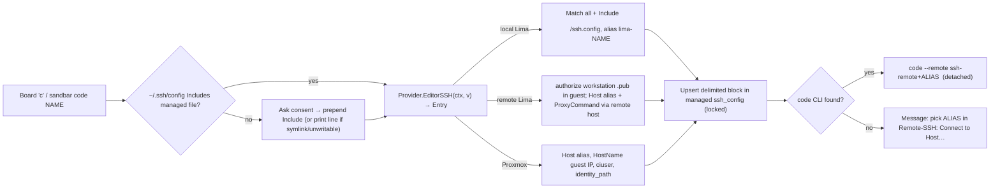
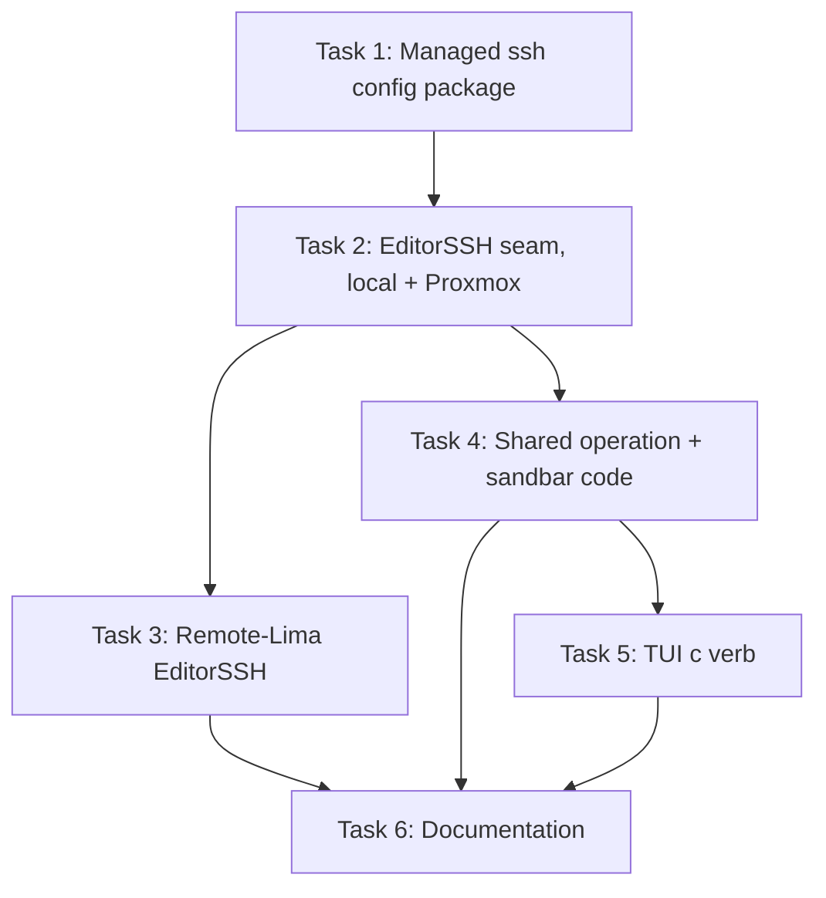

# Plan: Open VMs in VS Code Remote-SSH

## Original Work Order

> GitHub issue https://github.com/Lullabot/sandbar/issues/341 — "Support opening VS Code in remote mode easily". Issue body: "This is doable today by installing the Remote SSH plugin, and then running `limactl show-ssh` to get the SSH string. You paste that in the new configuration, and you can load VS code remotely. New users often want to work using this workflow, so let's make it easy. The hard part is figuring out where it makes sense in the TUI to expose it." Define and implement how this works across all providers (local Lima, remote Lima over SSH, Proxmox). The user is open to either (a) providing a copy-paste string to configure VS Code Remote-SSH, or (b) directly configuring VS Code / the user's ssh config, if that is reliable and possible.

## Plan Clarifications

| Question | Answer |
| --- | --- |
| How deep should the integration go? | Managed ssh config + launch: sandbar maintains its own ssh config file, and a TUI verb / `sandbar code NAME` writes the VM's entry and runs `code --remote ssh-remote+<alias> <dir>`. When `code` cannot be found, it tells the user which host alias to pick in VS Code. |
| How does the `Include` line reach `~/.ssh/config`? | Offer to add it: on first use sandbar asks for confirmation, then prepends the line (creating the file 0600 if missing). If the file is a symlink or cannot be written, it prints the line to add by hand instead. |
| How do remote-Lima VMs get access, given their guest trusts only the remote host's Lima key? | Authorize the workstation key: each time the verb runs, sandbar appends the workstation's public key (the profile's `identity_path` + `.pub`, else the first default `~/.ssh/id_*.pub`) to the guest's `authorized_keys`; the entry tunnels through the remote host. A reset wipes it; the next use re-adds it. |
| Key and command name? | Board verb `c` ("code"), enabled on running VMs; CLI `sandbar code NAME [--profile NAME]`. |
| Backwards compatibility? | Purely additive; nothing existing changes behaviour. No BC work required. |

## Executive Summary

Users who want to work in VS Code today must find a VM's ssh details by hand (`limactl show-ssh`, which is deprecated and also goes stale, because Lima picks a new ssh port on every start), paste them into `~/.ssh/config`, and repeat that after restarts. Remote-Lima and Proxmox VMs have no documented path at all.

This plan adds one verb, `c` on the board and `sandbar code NAME` on the CLI, that makes the VM reachable as a named ssh host and opens VS Code's Remote-SSH window on the VM's project checkout. sandbar owns a single ssh config file (`${XDG_CONFIG_HOME:-~/.config}/sandbar/ssh_config`) holding one delimited block per VM. With the user's one-time consent, it adds an `Include` for that file at the top of `~/.ssh/config`. Each backend contributes the block it needs: local Lima includes Lima's own per-instance `ssh.config`, so the entry never goes stale; Proxmox writes the guest IP and the profile's key; remote Lima tunnels through the remote host with a ProxyCommand after authorizing the workstation key in the guest.

Writing a real ssh config, rather than printing a snippet, is what makes it reliable: VS Code's Remote-SSH, plain `ssh`, `scp` and any other ssh-based tool all resolve the same host name, and the local-Lima entry tracks port changes on its own.

## Context

### Current State vs Target State

| Current State | Target State | Why? |
| --- | --- | --- |
| No way to get a VM's ssh connection details from sandbar. | `c` / `sandbar code NAME` writes an ssh host entry and opens VS Code on it. | New users expect to work in VS Code; the issue asks for this to be easy. |
| Local Lima users paste `limactl show-ssh` output that breaks when the VM restarts on a new port. | The local entry `Include`s Lima's per-instance `ssh.config`, which Lima rewrites on each start. | A pasted port goes stale silently. |
| Remote-Lima guests trust only the remote host's Lima key, so the workstation cannot ssh in. | The verb authorizes the workstation's public key in the guest and the entry tunnels via the remote host. | Without this, remote-Lima VMs cannot be opened from the workstation at all. |
| Proxmox guests are reachable only through sandbar's internal ssh argv. | A Host entry with the current guest IP, the profile key and the throwaway-host-key posture. | Same goal, no Lima in front of the guest. |
| `~/.ssh/config` is never touched by sandbar. | With explicit consent, one `Include` line is prepended once. | The managed file is invisible to ssh without it. |

### Background

- Lima ≥ 1.0 assigns a random host ssh port per start and rewrites `<LIMA_HOME>/<name>/ssh.config` (Host `lima-<name>`) at start. Lima's own docs recommend `Include ~/.lima/*/ssh.config`. OpenSSH silently ignores an `Include` of a path that does not exist, so an entry for a deleted VM is harmless.
- OpenSSH scopes an `Include` written after a `Host` line to that `Host` block. Every block in the managed file must therefore start with a scope reset (`Match all`) before an `Include`, and the line in `~/.ssh/config` must come before any `Host`/`Match` line, which is why sandbar prepends it.
- The Proxmox provider already reaches guests with `sshx` using `IdentitiesOnly=yes` and the ephemeral host-key posture (`StrictHostKeyChecking=no`, `UserKnownHostsFile=/dev/null`, `LogLevel=ERROR`); the entry must mirror these for the reasons documented on `sshx.Config`.
- The remote-Lima provider reaches the remote host with `lima.SSHHost`/`sshx.Conn` (host/user/port/identity from the profile). The guest's instance dir on that host is `vm.VM.Dir`; its `ssh.config` there knows the current port, so a ProxyCommand that runs `ssh -F <Dir>/ssh.config -W 127.0.0.1:22 lima-<name>` on the remote host gives a port-independent stream to the guest's sshd.
- `provision.CheckoutRelDir(cloneURL)` already mirrors the project role's checkout layout (`~/<host>/<org>/<repo>`); combined with `Provider.GuestHome(v)` it gives the folder to open. With no clone URL, VS Code opens the guest home.
- `code --remote ssh-remote+<alias> <absolute guest path>` opens a Remote-SSH window. On macOS the `code` shell command is often not on PATH; the app bundle ships it at `/Applications/Visual Studio Code.app/Contents/Resources/app/bin/code`.
- Plan 14 explicitly deferred "surfacing Lima's ssh.config for VS Code Remote-SSH"; this plan picks it up.

## Architectural Approach

### Managed ssh config package

**Objective**: One small, dependency-free package (`internal/sshconfig`) that owns the managed file and the `Include` in `~/.ssh/config`, so the TUI and CLI share a single implementation.

- `Entry` is a backend-neutral description: an alias plus either an `Include` path (local Lima) or Host options (HostName, User, Port, IdentityFile, IdentitiesOnly, ProxyCommand, ephemeral-host-key flag). It renders to text deterministically. Every block begins with `Match all` so ordering inside the file never scopes one entry under another.
- `Upsert(entry)` replaces or appends the block delimited by `# sandbar begin <alias>` / `# sandbar end <alias>` in the managed file, written 0600 via temp file + rename, under a `statelock` lock with re-read-then-write (the same `mutate` discipline the other stores use). `Remove(alias)` drops a block; the board's delete verb calls it so a deleted Proxmox VM does not leave an alias pointing at a recycled IP.
- `IncludeStatus()` reports whether `~/.ssh/config` already includes the managed file (matching the absolute path or its `~/` form), whether the file is a symlink, and whether it is writable. `AddInclude()` prepends `Include <abs path>` plus a short comment, creating `~/.ssh` (0700) and the config (0600) when absent, and refuses symlinks and unwritable files with an error that carries the exact line to add.
- Aliases: local Lima uses Lima's own `lima-<name>`; remote Lima and Proxmox use `sandbar-<profile-slug>-<name>` so same-named VMs on different profiles never collide. The slug is lowercase alphanumerics and hyphens.
- Values written into the config are validated (no newlines, quotes as needed for paths with spaces) so a VM or profile field can never inject extra directives.

### Provider seam: `EditorSSH`

**Objective**: Each backend states how a workstation ssh client reaches its guest, keeping backend knowledge inside `internal/provider`.

Add `EditorSSH(ctx context.Context, v vm.VM) (sshconfig.Entry, error)` to `Provider` (and a field to `providerfake.Provider`). It may do I/O, unlike `AttachArgv`, because Proxmox must resolve the guest IP and remote Lima must authorize a key; callers run it off the TUI update goroutine.

- **Local Lima**: an Include entry for `<v.Dir>/ssh.config`, alias `lima-<name>`. No I/O beyond confirming the file exists.
- **Proxmox**: resolve the IP through the existing bounded `guestIP`; entry with `HostName <ip>`, `User <ciuser>`, `IdentityFile <identity_path>`, `IdentitiesOnly yes`, and the ephemeral host-key options, matching `sshHost`.
- **Remote Lima**: pick the workstation key pair (profile `identity_path` and its `.pub`; otherwise the first of `~/.ssh/id_ed25519`, `id_ecdsa`, `id_rsa` that has a `.pub`; otherwise an error explaining how to set `identity_path`). Append the public key to the guest's `~/.ssh/authorized_keys` idempotently via the provider's guest transport, passing the key on stdin, never as command text, and creating `~/.ssh` 0700 / the file 0600. The entry uses `HostName 127.0.0.1`, `User <GuestUser(v)>`, `IdentityFile <workstation key>`, `IdentitiesOnly yes`, ephemeral host-key options, and a `ProxyCommand` that sshes to the remote host (same host/user/port/identity as the profile) and runs `ssh -F <v.Dir>/ssh.config -W 127.0.0.1:22 lima-<name>` there. Each remote token is quoted with `sshx.Quote`.

### Shared operation and launcher

**Objective**: A single function both entry points call, so the TUI and CLI cannot drift (the AGENTS.md parity rule).

A function in `internal/manage` (or a small `internal/vscode` package if that avoids an import cycle) takes a provider and VM, calls `EditorSSH`, upserts the entry, computes the folder (`GuestHome(v)` + `/` + `CheckoutRelDir(cloneURL)` when the VM has a clone URL, else `GuestHome(v)`), and locates `code` (PATH, then the macOS app-bundle path). It returns a result describing the alias, the folder, and the argv to launch, or "not found" so the caller can print the Remote-SSH fallback instruction. The launcher starts `code` detached (no TTY handoff: `code` returns immediately) through a seam that tests replace, so no test opens VS Code.

### TUI verb `c`

**Objective**: Discoverable, one-key access from the tile under the focus ring.

Add a `vmCommands` entry `c code` with an `about` sentence for the `?` screen, enabled when the VM is running and not building. If `IncludeStatus` shows the line missing and the file is writable, show a y/n confirmation overlay naming the exact line and file; on `y` add it, on `n` continue without it and say the alias will not resolve until the line is added. For a symlinked or unwritable config, skip the overlay and show the line to add. The `EditorSSH` + upsert + launch run as an async `tea.Cmd`; the result is a status message ("Opening VS Code on lima-foo…" or the fallback instruction naming the alias). Update the affected goldens.

### CLI `sandbar code NAME [--profile NAME]`

**Objective**: CLI parity with the board verb.

Resolve the owning profile with `resolveVMProfile`, refuse a VM that is not running with a clear message, prompt `y/N` on a terminal before adding the `Include` (non-interactive stdin: never edit, print the line), then call the shared operation and either launch `code` or print the alias and Remote-SSH instruction.

## Risk Considerations and Mitigation Strategies

Technical Risks

- **Editing `~/.ssh/config` could break the user's ssh setup**: a malformed or mis-scoped line affects every ssh connection.
    - **Mitigation**: only ever prepend one `Include` line with a comment, only after consent, atomically via temp file + rename preserving mode; refuse symlinks; tests run `ssh -G` against the result to prove it parses and resolves the alias.
- **Include scoping**: an `Include` after a `Host` line in either file would be conditional and silently ineffective.
    - **Mitigation**: prepend (never append) in `~/.ssh/config`; every managed block starts with `Match all`; a test asserts `ssh -G` resolves two different aliases from one managed file.
- **Remote-Lima nested `-W` needs `AllowTcpForwarding` in the guest sshd**: Debian/Ubuntu default allows it, but a hardened guest would refuse.
    - **Mitigation**: the role does not disable it today; document the requirement in the troubleshooting docs.
- **Proxmox IP changes** after a lease change make the entry stale.
    - **Mitigation**: the verb refreshes the IP on every use; reset preserves the MAC so the lease usually holds; document "press `c` again".
- **Config injection**: VM names, paths or profile fields written into the config could add directives.
    - **Mitigation**: reject values containing newlines or control characters and quote paths; unit tests cover hostile values.

Implementation Risks

- **Lost updates when two sandbar processes write the managed file**.
    - **Mitigation**: `statelock` plus re-read before write, matching the registry/profiles discipline.
- **Tests touching the developer's real `~/.ssh/config` or launching VS Code**.
    - **Mitigation**: tests set `HOME` and `XDG_CONFIG_HOME` to temp dirs and replace the launcher and `code` lookup with seams.
- **Authorizing the wrong key on remote Lima** (e.g. a key the user did not intend to expose).
    - **Mitigation**: prefer the profile's explicit `identity_path`; state in the TUI/CLI message and docs which public key was authorized.

## Success Criteria

### Primary Success Criteria

1. Pressing `c` on a running VM tile (or running `sandbar code NAME`) writes that VM's block to the managed ssh config and launches `code --remote ssh-remote+<alias> <folder>`, where the folder is the project checkout when the VM has a clone URL, else the guest home.
2. With `ssh -F <test ~/.ssh/config>`, `ssh -G <alias>` resolves the expected HostName/User/Port/IdentityFile/ProxyCommand for each backend's entry, including two entries from one managed file.
3. The `Include` line is added only after explicit confirmation, at the top of `~/.ssh/config`; a symlinked or unwritable config is never modified and the user is shown the exact line instead.
4. For remote Lima, the workstation public key ends up in the guest's `authorized_keys` exactly once after repeated invocations, and the key never appears in a guest command line.
5. When `code` is not found, the user is told which alias to pick in "Remote-SSH: Connect to Host…".
6. `go test ./...`, `go vet ./...`, `gofmt -l .` and `mkdocs build --strict` pass; the coverage floor holds.

## Self Validation

1. `go build ./cmd/sandbar && go vet ./... && gofmt -l . && go test ./...`, all clean.
2. In a scratch `HOME`, run the `internal/sshconfig` tests and additionally hand-check: create a fake `~/.ssh/config` with existing `Host` blocks, run `AddInclude` via a test, and run `ssh -F <that file> -G lima-foo` / `ssh -G sandbar-pve-foo` to confirm resolution (hostname, port, user, identityfile, proxycommand lines).
3. With a real local Lima VM on this box (limactl 2.2.0 is installed), create or reuse a running managed VM, run `HOME=<scratch> ./sandbar code <name>` with `code` absent from PATH, confirm the printed alias, then `ssh -F <scratch>/.ssh/config <alias> true` exits 0. Restart the VM and repeat the ssh to confirm the entry survives the port change. If no Lima VM can be booted, record that and rely on the `ssh -G` evidence.
4. Run `go test ./internal/ui -run TestTUI` and inspect the golden diffs: only the help/footer text for `c code` and the new overlay should change.
5. `uvx --with-requirements docs/requirements.txt mkdocs build --strict`.

## Documentation

- `docs/using-sand/` — a new "VS Code" section (in `files-and-shells.md` or a new page added to `mkdocs.yml` nav) covering the verb, what is written where, the one-time Include, per-backend behaviour (remote Lima key authorization and reset re-authorization, Proxmox IP refresh), and the `code` CLI on macOS.
- `docs/using-sand/cli-reference.md` — `sandbar code`.
- `docs/using-sand/tui.md` — the `c` key.
- `docs/reference/files-and-state.md` — the managed `ssh_config` file and the `~/.ssh/config` edit.
- `AGENTS.md` — `EditorSSH` on the provider seam, `internal/sshconfig`, the `c` ↔ `sandbar code` parity pair, and the Include-scoping / prepend rule.

## Resource Requirements

### Development Skills

Go (Bubble Tea v2 TUI, CLI), OpenSSH client configuration semantics, Lima and Proxmox provider internals.

### Technical Infrastructure

Go toolchain, OpenSSH client (`ssh -G` in tests, skipped when absent), local Lima for the manual check, `uv` for the docs build. No new module dependencies.

## Notes

- Out of scope: VS Code forks (Cursor, etc.), editing VS Code's own settings, Windows-specific `code` discovery beyond PATH, and a copy-paste-only mode.
- `limactl show-ssh` is deprecated upstream; this plan does not use it.

## Execution Blueprint

**Validation Gates:**
- Reference: `/config/hooks/POST_PHASE.md`

### Dependency Diagram

### ✅ Phase 1: SSH config foundation
**Parallel Tasks:**
- ✔️ Task 1: Managed ssh config package

### Phase 2: Provider seam
**Parallel Tasks:**
- Task 2: `Provider.EditorSSH` for local Lima and Proxmox (depends on: 1)

### Phase 3: Remote Lima and shared operation
**Parallel Tasks:**
- Task 3: Remote-Lima `EditorSSH` (depends on: 2)
- Task 4: Shared operation and `sandbar code` CLI (depends on: 2)

### Phase 4: TUI
**Parallel Tasks:**
- Task 5: TUI `c code` verb (depends on: 4)

### Phase 5: Documentation
**Parallel Tasks:**
- Task 6: Documentation and AGENTS.md (depends on: 3, 4, 5)

### Post-phase Actions

### Execution Summary
- Total Phases: 5
- Total Tasks: 6
