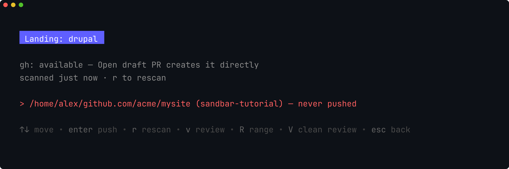
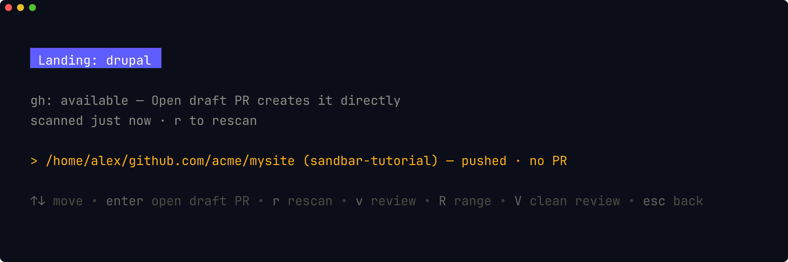
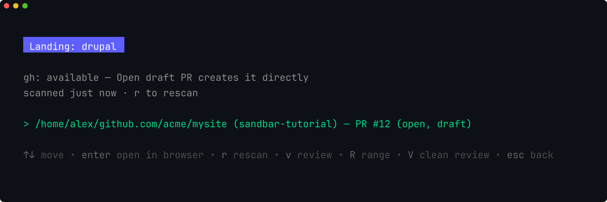

# Your first pull request

This is the loop you'll repeat every day with sandbar: an agent makes a change in its VM, you review it in your browser, and the change leaves the VM as a pull request. Sandbar never copies the code to your workstation: the VM pushes it straight to GitHub.

It picks up where the [quickstart](quickstart.md) left off. In this tutorial you'll:

- Have Claude Code make a small change on a new branch.
- Review the change in your browser and leave a comment.
- Have Claude Code apply your comment.
- Push the branch and open a draft pull request from the board.

By the end, you'll have a draft pull request on GitHub with Claude Code's change, reviewed by you before it left the VM.

## Before you start

You need:

- The `drupal` VM from the [quickstart](quickstart.md), running, with Claude Code signed in.
- A project on GitHub that you can push to. Landing opens pull requests on GitHub only. If you used your fork of the demo site in the quickstart, that's the one, and your pull request opens in your fork.
- The token you gave the VM in the quickstart, with *Contents: Read and write*. If you created the VM without one, see [GitHub and GitLab tokens](../using-sandbar/secrets.md#github-and-gitlab-tokens) to add it.

- The [GitHub CLI](https://cli.github.com/), `gh`, installed and signed in on your workstation (`gh auth login`). Sandbar uses it to open the pull request as you, not as the VM.

Note: Without `gh`, everything still works up to the last step, and sandbar opens GitHub's compare page instead, where you can open the pull request yourself.

## 1. Ask Claude Code for a change

On the board, press `S` on the `drupal` tile. In your project folder, start Claude Code if it isn't running:

```console
$ claude
```

Type this prompt and press `enter`:

```text
Create a branch called sandbar-tutorial. In README.md, add a short "Local development" section that explains how to start the site with DDEV. Commit the change.
```

Claude Code creates the branch, edits `README.md` and commits, without asking for approval.

## 2. Open the Landing pane

Press `ctrl+a`, then `d`, to go back to the board. Claude Code keeps running.

Press `l` on the `drupal` tile. The *Landing* pane lists the Git checkouts in the VM, one row per folder: its path, the branch checked out there, and whether that branch has been pushed or has a pull request. Your project has one row, showing the `sandbar-tutorial` branch and *never pushed*.



If the row still shows your old branch, press `r` to scan the VM again.

## 3. Review the change in your browser

With your project's row selected, press `v`. Sandbar starts a review with [self-review](https://github.com/e0ipso/self-review) and opens it in your browser. You'll see `README.md` with Claude Code's new section highlighted.

Leave one comment on a line in the new section, asking for something you'd like changed, for example:

```text
Also mention ddev import-db for loading a database dump.
```

Click **Finish Review**. Sandbar saves your comments in the VM as `review.xml`, in your project folder, and the review closes.

Learn more about [sandbar's review tools](../using-sandbar/review.md).

## 4. Have Claude Code apply your comment

Press `esc` to leave the Landing pane, then `S` on the tile to return to Claude Code.

Type:

```text
/self-review-apply review.xml
```

Claude Code reads your comment and updates `README.md`. If it already applied the review on its own, skip this. Then ask it to commit:

```text
Commit the change.
```

## 5. Push the branch

Press `ctrl+a`, then `d`, and press `l` on the tile again. Your project's row offers *push* at the bottom of the pane.

Press `enter`. Sandbar runs `git push` inside the VM, using the VM's token, and shows its output. When the push finishes, you're back on the pane, and the row offers *open draft PR*.



## 6. Open a draft pull request

Press `enter` again. Sandbar creates a draft pull request on GitHub with your workstation's `gh`, and shows its number and link.

Note: The VM's token can push branches, but with the [recommended permissions](../background/security-model.md#a-least-privilege-token-reasonable-agent-access) it can't open or merge pull requests. Opening one happens on your workstation, with your own `gh`, so an agent can push its work but only you decide what becomes a pull request.

Back on the pane, the row offers *open in browser*. If it doesn't yet, press `r`.



Press `enter` to open the pull request. You'll see both of Claude Code's commits, ready for you or a teammate to review.

## What you did

You ran the full loop: Claude Code made a change in its VM, you reviewed it in your browser, Claude Code applied your feedback, and the change left the VM as a draft pull request. The VM's token pushed the branch, and your own `gh` opened the pull request.

Next time, skip the tutorial branch name and ask Claude Code for real work. For example, give it the URL of a GitHub issue and ask it to work on that issue. With *Issues: Read* on the VM's token, it can read the issue with `gh`.

## Next steps

- [Review changes in a browser](../using-sandbar/review.md): review part of a branch, or pick up a review you left.
- [Landing](../using-sandbar/shells.md#landing): every state a checkout can be in, and what to do when `gh` isn't usable.
- [Security model](../background/security-model.md): why the VM pushes and your workstation opens the pull request.
